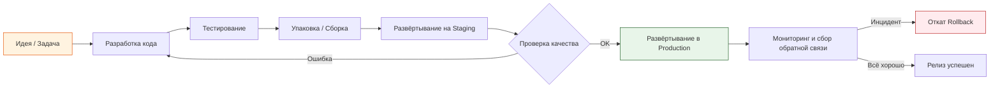
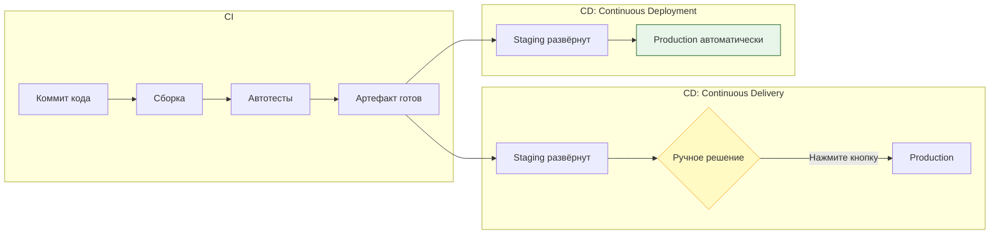
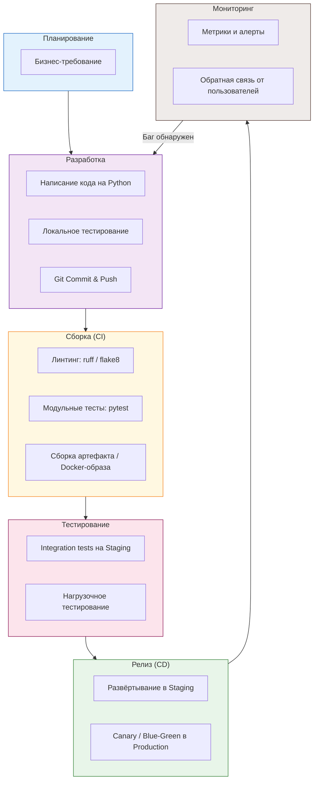

# Лекция 1: Введение в управление изменениями и релизами. Философия DevOps и CI/CD

---

## Цели лекции

После изучения этого материала вы сможете:
- Объяснить, зачем нужны процессы управления изменениями и релизами
- Различать понятия DevOps, CI, CD
- Понимать, какие риски возникают при отсутствии автоматизации
- Создать базовый Python-проект и написать скрипт, имитирующий ручной процесс релиза

---

## 1. Зачем вообще управлять изменениями? Вводная аналогия

Представьте, что вы — владелец сети из 50 ресторанов. Каждый день повара предлагают новые рецепты, меняют ингредиенты, обновляют меню. Если каждый повар в каждом ресторане начнёт менять блюда **спонтанно, без записи и согласования**, произойдёт хаос:

- Гость в Москве получит борщ с ананасом, а в Казани — без капусты.
- Вы не сможете выяснить, **кто** и **когда** изменил рецепт.
- Если гость отравится, вы не сможете **откатиться** к предыдущей версии блюда.

**В разработке ПО — абсолютно то же самое.** Код меняется десятки раз в день, десятками разработчиков. Без управления изменениями наступает хаос, который стоит миллионов.

>  **Термин: Change Management (Управление изменениями)**
> — формализованный процесс запроса, рассмотрения, одобрения и документирования изменений в программной системе или инфраструктуре.
> **Зачем нужно:** минимизировать риск того, что одно изменение сломает другую часть системы.
> **Пример:** Прежде чем обновить библиотеку `requests` с версии 2.28 на 2.31, команда проверяет, не сломает ли это интеграцию с внешним API.

---

## 2. Что такое управление релизами (Release Management)

> **Термин: Release Management (Управление релизами)**
> — планирование, координация и контроль процесса вывода новой версии программного продукта (релиза) в рабочую среду (production).
> **Зачем нужно:** гарантировать, что релиз предсказуем, воспроизводим и может быть отменён в случае проблем.
> **Пример:** Команда решает, что версия 2.1.0 выходит во вторник в 10:00 по UTC, включает 12 задач из спринта, и у неё есть план отката.

### Жизненный цикл релиза



**Описание диаграммы:**
Диаграмма показывает **полный жизненный цикл одного релиза** слева направо:
- **Жёлтый блок (Идея)** — точка входа: бизнес-требование или баг-репорт.
- **Серые блоки** — этапы разработки и проверки.
- **Зелёный блок (Production)** — успешное развёртывание для реальных пользователей.
- **Красный блок (Rollback)** — экстренный откат, если после релиза обнаружена критическая ошибка.
- **Ромб (Проверка качества)** — точка принятия решения: релизим или дорабатываем.

> **Термин: Production (Продакшен)**
> — рабочая среда, где приложение обслуживает реальных пользователей.
> **Пример:** Сервер `api.mybank.ru`, куда обращаются клиенты банка.

> **Термин: Staging (Стейджинг)**
> — тестовая среда, максимально приближённая к продакшену, но недоступная внешним пользователям.
> **Пример:** Сервер `staging-api.mybank.ru`, где QA-инженеры проверяют релиз перед выкладкой.

> **Термин: Rollback (Откат)**
> — процесс возврата системы к предыдущей стабильной версии после неудачного релиза.
> **Пример:** Версия 2.1.0 сломала авторизацию → откатываемся к 2.0.9 за 2 минуты.

---

## 3. Реальный кейс: цена ошибки в управлении релизами

### Инцидент Knight Capital Group (август 2012)

**Что произошло:**
Компания — один из крупнейших маркет-мейкеров на Нью-Йоркской фондовой бирже. При обновлении торгового алгоритма инженер **забыл скопировать новый код на один из 8 серверов**. На 7 серверах работал новый код, на 1-м — старый, с «мёртвым» флагом, который активировал устаревшую логику.

**Результат:**
- За **45 минут** алгоритм совершил миллионы ошибочных сделок.
- Компания потеряла **$440 000 000**.
- Компания обанкротилась и была продана.

**Причина с точки зрения нашей дисциплины:**
- Отсутствие автоматизированного **Release Management**: не было скрипта, который проверяет, что код идентичен на всех серверах.
- Отсутствие **Change Management**: изменение было внесено вручную, без чек-листа и верификации.
- Не было **автоматического отката** и мониторинга, который бы остановил аномалию за первые 30 секунд.

>**Вывод:** Управление изменениями и релизами — это не бюрократия. Это защита от потери сотен миллионов долларов и репутации.

---

## 4. DevOps: культура, а не должность

> **Термин: DevOps**
> — от **Dev**elopment (разработка) + **Op**eration**s** (эксплуатация). Набор практик, инструментов и культурных принципов, направленных на сокращение времени между написанием кода и его безопасной работой у пользователя.
> **Зачем нужно:** устранить «стену» между разработчиками и администраторами, ускорить доставку ценности.
> **Пример:** Раньше разработчик писал код и «перекидывал через стену» системному администратору со словами: «У меня работает, дальше ваши проблемы». В DevOps оба несут ответственность за результат.

### Аналогия: Ресторанная кухня

| Роль в старой модели | Роль в DevOps | Аналогия |
|---|---|---|
| Повар (Разработчик) | Шеф-повар, который сам следит за подачей | Пишет код И контролирует его работу в продакшене |
| Официант (Операции) | Официант, который знает рецепт | Админ, который понимает код и может его деплоить |
| «Стена» между кухней и залом | Общая кухня с открытой барной стойкой | Единый конвейер от коммита до мониторинга |

### Три ключевых принципа DevOps (The Three Ways)

1. **Flow (Поток)** — ускорить движение работы слева направо (от разработчика к пользователю).
2. **Feedback (Обратная связь)** — как можно быстрее узнать, что что-то пошло не так (справа налево: от продакшена к разработчику).
3. **Continual Learning (Непрерывное обучение)** — поощрять эксперименты, не наказывать за ошибки, улучшать процесс.

---

## 5. Непрерывная интеграция и доставка: CI/CD

### 5.1. Continuous Integration (CI) — Непрерывная интеграция

> **Термин: CI (Continuous Integration)**
> — практика, при которой разработчики **несколько раз в день** сливают свой код в общую ветку, и **каждое** слияние автоматически проверяется сборкой и тестами.
> **Зачем нужно:** обнаружить конфликт и баг в течение минут, а не в конце спринта, когда «всё сломано».
> **Пример:** Разработчик делает `git push`, и через 3 минуты видит: «Твой код ломает 2 теста — исправь». Без CI он бы узнал об этом через 2 недели.

### 5.2. Continuous Delivery vs Continuous Deployment (CD)

> **Термин: CD — Continuous Delivery (Непрерывная доставка)**
> — каждая успешная сборка **автоматически готова** к развёртыванию в продакшен, но само развёртывание запускается **вручную** (нажатием кнопки).
> **Пример:** Билд собран, тесты прошли, артефакт лежит на складе. Менеджер нажимает «Deploy» в пятницу в 10:00.

> **Термин: CD — Continuous Deployment (Непрерывное развёртывание)**
> — каждая успешная сборка **автоматически** развёртывается в продакшен **без участия человека**.
> **Пример:** Разработчик сделал `git push` → через 7 минут код уже работает у пользователей. Так работают Netflix, Amazon, Google.

### Разница между Delivery и Deployment



**Описание диаграммы:**
- **Блок CI** (слева) — одинаков для обоих подходов: код → сборка → тесты → готовый артефакт.
- **Верхняя ветка (Delivery):** после стейджинга стоит **ромб принятия решения** (жёлтый) — человек решает, когда деплоить.
- **Нижняя ветка (Deployment):** после стейджинга идёт **прямая стрелка** в продакшен (зелёный) — автоматика, без участия человека.

---

## 6. Полный конвейер: от идеи до пользователя



**Описание диаграммы:**
Диаграмма показывает **полный цикл DevOps** в виде вертикального потока из 6 этапов:
1. **Планирование** (синий) — что мы хотим сделать.
2. **Разработка** (фиолетовый) — пишем код на Python, коммитим.
3. **Сборка / CI** (жёлтый) — автоматическая проверка качества.
4. **Тестирование** (розовый) — проверка в условиях, близких к реальным.
5. **Релиз / CD** (зелёный) — выкатываем пользователям.
6. **Мониторинг** (коричневый) — следим за поведением.
- **Пунктирная стрелка снизу вверх** показывает петлю обратной связи: если мониторинг выявил баг, мы возвращаемся к этапу разработки.

---

## 7. Ключевые артефакты и окружения

> **Термин: Artifact (Артефакт)**
> — результат процесса сборки, который можно раз развернуть. Это может быть `.whl`-файл, `.tar.gz`-архив, Docker-образ.
> **Зачем нужно:** артефакт неизменяем (immutable). Вы всегда знаете, что именно было задеплоено.
> **Пример:** Файл `myapp-1.2.3-py3-none-any.whl` или Docker-образ `registry.example.com/myapp:1.2.3`.

> **Термин: Environment (Окружение)**
> — набор серверов и конфигураций, объединённых общей целью.
> **Пример:** `dev` (локальная разработка), `staging` (предпродакшен), `production` (реальные пользователи).

---

## 8. Практическое задание №1

### Цель
Создать Python-проект, структурировать его как реальный сервис и написать скрипт, который **вручную** имитирует процесс релиза. Это поможет понять, **что** мы будем автоматизировать в дальнейших лекциях.

### Шаги выполнения

#### Шаг 1: Создание структуры проекта

Создайте следующую структуру:

```
release_lab/
├── pyproject.toml          # Метаданные проекта
├── src/
│   └── todo_api/
│       ├── __init__.py
│       └── app.py          # Основное приложение
├── tests/
│   ├── __init__.py
│   └── test_app.py         # Тесты
├── scripts/
│   └── release.py          # Скрипт релиза (мы напишем его)
└── README.md
```

#### Шаг 2: Файл `pyproject.toml`

```toml
[build-system]
requires = ["setuptools>=68.0", "wheel"]
build-backend = "setuptools.build_meta"

[project]
name = "todo-api"
version = "0.1.0"
description = "Простой Todo API для курса по управлению релизами"
requires-python = ">=3.11"
dependencies = [
    "fastapi>=0.110.0",
    "uvicorn>=0.29.0",
]

[project.optional-dependencies]
dev = [
    "pytest>=8.0",
    "ruff>=0.4.0",
]
```

> **Термин: `pyproject.toml`**
> — единый файл конфигурации Python-проекта (стандарт PEP 621). Содержит метаданные, зависимости, настройки инструментов.
> **Зачем нужно:** заменяет устаревшие `setup.py`, `setup.cfg`, `requirements.txt` в одном месте.

#### Шаг 3: Основное приложение `src/todo_api/app.py`

```python
"""Простой Todo API для демонстрации процесса релизов."""

from fastapi import FastAPI, HTTPException
from pydantic import BaseModel

app = FastAPI(title="Todo API", version="0.1.0")

# Имитация хранилища в памяти
todos: list[dict] = []
_next_id: int = 1


class TodoCreate(BaseModel):
    title: str
    completed: bool = False


class TodoResponse(BaseModel):
    id: int
    title: str
    completed: bool


@app.get("/health")
def health_check() -> dict:
    """Проверка работоспособности сервиса."""
    return {"status": "ok", "version": app.version}


@app.post("/todos", response_model=TodoResponse, status_code=201)
def create_todo(todo: TodoCreate) -> TodoResponse:
    """Создать новую задачу."""
    global _next_id
    new_todo = {"id": _next_id, "title": todo.title, "completed": todo.completed}
    todos.append(new_todo)
    _next_id += 1
    return TodoResponse(**new_todo)


@app.get("/todos", response_model=list[TodoResponse])
def list_todos() -> list[TodoResponse]:
    """Получить список всех задач."""
    return [TodoResponse(**t) for t in todos]


@app.get("/todos/{todo_id}", response_model=TodoResponse)
def get_todo(todo_id: int) -> TodoResponse:
    """Получить задачу по ID."""
    for todo in todos:
        if todo["id"] == todo_id:
            return TodoResponse(**todo)
    raise HTTPException(status_code=404, detail="Todo not found")
```

#### Шаг 4: Тесты `tests/test_app.py`

```python
"""Модульные тесты для Todo API."""

from fastapi.testclient import TestClient
from todo_api.app import app

client = TestClient(app)


def test_health_check():
    """Проверяем, что эндпоинт здоровья возвращает статус ок."""
    response = client.get("/health")
    assert response.status_code == 200
    data = response.json()
    assert data["status"] == "ok"


def test_create_todo():
    """Проверяем создание задачи."""
    response = client.post("/todos", json={"title": "Изучить DevOps"})
    assert response.status_code == 201
    data = response.json()
    assert data["title"] == "Изучить DevOps"
    assert data["completed"] is False
    assert "id" in data
```

#### Шаг 5: Скрипт релиза `scripts/release.py`

Это **главное задание** лекции. Скрипт имитирует ручной процесс релиза:

```python
#!/usr/bin/env python3
"""
Скрипт ручного релиза.
Имитирует процесс, который мы будем автоматизировать в следующих лекциях.

Использование:
    python scripts/release.py
"""

import datetime
import hashlib
import shutil
import sys
import tarfile
from pathlib import Path

# Конфигурация 
PROJECT_NAME = "todo-api"
VERSION = "0.1.0"  # В реальном проекте читали бы из pyproject.toml
BUILD_DIR = Path("dist")
RELEASE_LOG = Path("release_log.md")


def get_version() -> str:
    """Читает версию из pyproject.toml (упрощённый парсинг)."""
    pyproject = Path("pyproject.toml")
    if not pyproject.exists():
        print("Файл pyproject.toml не найден!")
        sys.exit(1)

    for line in pyproject.read_text().splitlines():
        if line.strip().startswith("version"):
            # version = "0.1.0" → 0.1.0
            return line.split("=")[1].strip().strip('"')
    return VERSION


def calculate_checksum(file_path: Path) -> str:
    """Вычисляет SHA-256 хеш файла для контроля целостности артефакта."""
    sha256 = hashlib.sha256()
    with open(file_path, "rb") as f:
        for chunk in iter(lambda: f.read(8192), b""):
            sha256.update(chunk)
    return sha256.hexdigest()


def build_artifact(version: str) -> Path:
    """Упаковывает исходный код в .tar.gz архив (артефакт релиза)."""
    print(f"Собираю артефакт: {PROJECT_NAME}-{version}")

    BUILD_DIR.mkdir(exist_ok=True)
    artifact_name = f"{PROJECT_NAME}-{version}.tar.gz"
    artifact_path = BUILD_DIR / artifact_name

    with tarfile.open(artifact_path, "w:gz") as tar:
        tar.add("src", arcname="src")
        tar.add("pyproject.toml")

    print(f"Артефакт создан: {artifact_path}")
    return artifact_path


def generate_release_notes(version: str, artifact_path: Path) -> str:
    """Генерирует примитивный лог релиза."""
    checksum = calculate_checksum(artifact_path)
    timestamp = datetime.datetime.now(datetime.UTC).strftime("%Y-%m-%d %H:%M:%S UTC")

    notes = f"""# Release Notes

## {PROJECT_NAME} v{version}

- **Дата релиза:** {timestamp}
- **Артефакт:** `{artifact_path.name}`
- **SHA-256:** `{checksum}`
- **Размер:** {artifact_path.stat().st_size} байт

### Что входит в релиз
- Базовый Todo API (health, CRUD для задач)
- Модульные тесты

### Статус
Готов к развёртыванию на Staging
"""
    return notes


def validate_artifact(artifact_path: Path) -> bool:
    """Проверяет, что артефакт существует и не пуст."""
    if not artifact_path.exists():
        print("Артефакт не найден!")
        return False
    if artifact_path.stat().st_size == 0:
        print("Артефакт пуст!")
        return False
    print(f"Артефакт валиден ({artifact_path.stat().st_size} байт)")
    return True


def main() -> None:
    """Основной процесс ручного релиза."""
    print("=" * 60)
    print(f"ПРОЦЕСС РЕЛИЗА: {PROJECT_NAME}")
    print("=" * 60)

    # Шаг 1: Определение версии
    version = get_version()
    print(f"\nВерсия релиза: {version}")

    # Шаг 2: Сборка артефакта
    print("\nЭтап сборки...")
    artifact_path = build_artifact(version)

    # Шаг 3: Валидация
    print("\nЭтап валидации...")
    if not validate_artifact(artifact_path):
        print("Релиз прерван: артефакт не прошёл валидацию.")
        sys.exit(1)

    # Шаг 4: Генерация release notes
    print("\nГенерация release notes...")
    notes = generate_release_notes(version, artifact_path)
    RELEASE_LOG.write_text(notes)
    print(f"Лог записан в {RELEASE_LOG}")

    # Шаг 5: Имитация деплоя
    print("\n Этап развёртывания (имитация)...")
    print("   Копирую артефакт на 'сервер'...")
    # В реальном мире здесь был бы scp / docker push / ansible
    # Мы просто подтверждаем, что артефакт готов
    print(f"    Артефакт {artifact_path.name} готов к деплою на Staging")

    print("\n" + "=" * 60)
    print(" РЕЛИЗ УСПЕШНО ЗАВЕРШЁН (в ручном режиме)")
    print("=" * 60)
    print("\n⚠  На следующих лекциях мы автоматизируем каждый из этих шагов!")


if __name__ == "__main__":
    main()
```

#### Шаг 6: Запуск и проверка

Установите зависимости и запустите скрипт:

```bash
# Создаём виртуальное окружение
python -m venv .venv
source .venv/bin/activate  # Windows: .venv\Scripts\activate

# Устанавливаем зависимости
pip install -e ".[dev]"

# Запускаем скрипт релиза
python scripts/release.py
```

**Ожидаемый вывод:**

```
============================================================
 ПРОЦЕСС РЕЛИЗА: todo-api
============================================================

 Версия релиза: 0.1.0

 Этап сборки...
 Собираю артефакт: todo-api-0.1.0
    Артефакт создан: dist/todo-api-0.1.0.tar.gz

 Этап валидации...
    Артефакт валиден (1234 байт)

 Генерация release notes...
    Лог записан в release_log.md

 Этап развёртывания (имитация)...
   → Копирую артефакт на 'сервер'...
    Артефакт todo-api-0.1.0.tar.gz готов к деплою на Staging

============================================================
 РЕЛИЗ УСПЕШНО ЗАВЕРШЁН 
============================================================

 На следующих лекциях мы автоматизируем каждый из этих шагов!
```

#### Шаг 7: Запуск тестов (убедитесь, что проект рабочий)

```bash
pytest tests/ -v
```

**Ожидаемый вывод:**
```
tests/test_app.py::test_health_check PASSED
tests/test_app.py::test_create_todo PASSED
```

---

## 9. Чек-лист для самопроверки

После выполнения практической работы убедитесь, что вы можете ответить на вопросы:

- [ ] Что такое Change Management и почему без него нельзя?
- [ ] Чем отличается Continuous Delivery от Continuous Deployment?
- [ ] Что такое артефакт и почему он должен быть неизменяемым (immutable)?
- [ ] Какие 3 принципа лежат в основе DevOps?
- [ ] Что произойдёт, если в команде из 10 человек нет управления релизами?
- [ ] Что делает каждая функция в `release.py`?
- [ ] Что такое SHA-256 и зачем мы вычисляем хеш артефакта?

> **Термин: SHA-256**
> — криптографическая хеш-функция, которая превращает файл любого размера в уникальную строку из 64 символов. Если файл изменится хотя бы на 1 бит — хеш полностью изменится.
> **Зачем нужно:** гарантирует, что артефакт не был повреждён или подменён при передаче.
> **Пример:** Хеш `a3f2b7...` для `todo-api-0.1.0.tar.gz`. При скачивании с сервера мы сравниваем хеш: совпал → файл цел.

---

## 10. Итоги лекции

| Понятие | Суть | Аналогия |
|---|---|---|
| Change Management | Контроль и документация изменений | Рецепт блюда: записываем, кто и что изменил |
| Release Management | Планирование и координация выпуска версии | Расписание поездов: известно, когда и что отправляется |
| DevOps | Культура объединения разработки и эксплуатации | Открытая кухня, где повар видит реакцию гостя |
| CI | Автосборка и автотесты при каждом коммите | Конвейер с проверкой качества на каждом этапе |
| CD (Delivery) | Автосборка + ручная кнопка «Деплой» | Грузовик приехал на склад, но водитель ждёт команду |
| CD (Deployment) | Полностью автоматический деплой | Конвейер доставляет посылку до двери без участия курьера |
| Артефакт | Неизменяемый результат сборки | Запечатанная коробка с товаром и штрихкодом |

---

## Дополнительное чтение

1. Gene Kim, Jez Humble, Patrick Debois, John Willis — *«The Phoenix Project»* (роман о внедрении DevOps)
2. Jez Humble, David Farley — *«Continuous Delivery»* (библия CI/CD)
3. Документация FastAPI: https://fastapi.tiangolo.com/
4. PEP 621 — стандарт метаданных в `pyproject.toml`

---

> **Слово преподавателя:** Сегодня мы прошли путь вручную — как это делали в 2005 году. Каждый шаг в `release.py` — это то, что мы будем автоматизировать. На следующей лекции мы погрузимся в Git и стратегии ветвления — фундамент, без которого невозможна ни одна современная CI/CD-практика. До встречи!

---

*Если у вас есть вопросы по материалу или возникли трудности при выполнении практической работы — фиксируйте их, мы разберём на следующем занятии.*