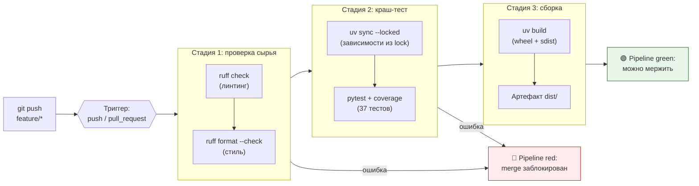
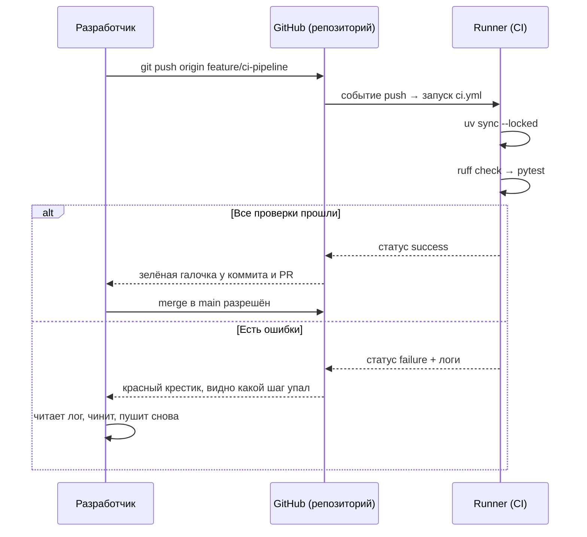
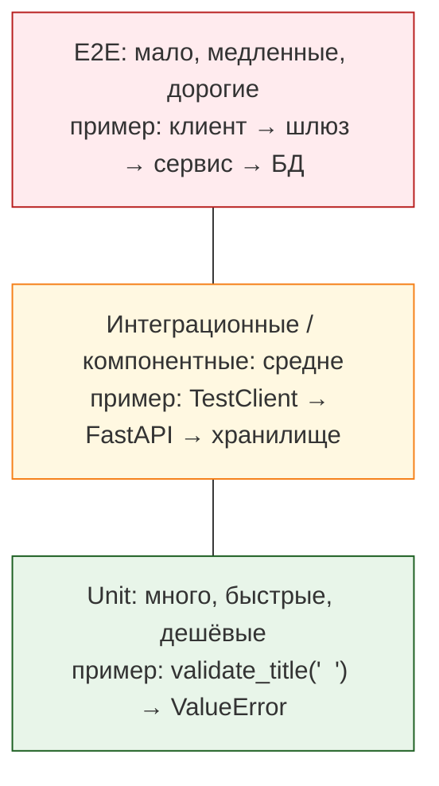
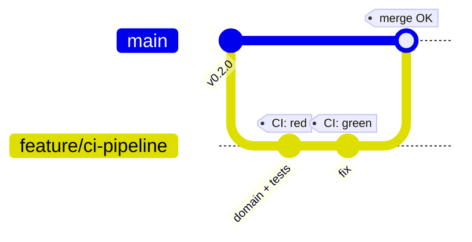

# Лекция 3: Непрерывная интеграция (CI). Автоматизация сборки и тестирования

---

## Цели лекции

После изучения этого материала вы сможете:
- Объяснить, что такое CI-конвейер и из каких элементов он состоит (pipeline, stage, job, runner)
- Настроить линтер `ruff` и понять, какие дефекты он ловит **до запуска** кода
- Отличать модульные тесты от интеграционных и писать изолированные тесты на `pytest`
- Понимать, что значит «сборка» для Python-проекта и зачем нужен lock-файл
- Самостоятельно создать первый CI-конвейер в `.github/workflows/ci.yml` (или `.gitlab-ci.yml`),
  который запускает линтер и тесты при каждом пуше в ветку `feature/*`
- Настроить «ворота качества»: красный конвейер блокирует слияние в `main`

**Место в курсе:** в лекции 1 мы написали `scripts/release.py` и прошли релиз *вручную*.
В лекции 2 разобрали Git и feature-ветки. Сегодня мы автоматизируем первые этапы нашего
конвейера из лекции 1: **проверку качества кода при каждом изменении**. Работаем с общим
проектом курса — Todo API из `practics/pract1/`.

---

## 1. Зачем нужен CI: проблема «интеграционного ада»

### 1.1. Ситуация без CI

Вспомним нашу сеть ресторанов из лекции 1. Теперь представьте, что 10 поваров неделю
готовят каждый своё блюдо **у себя дома**, а в субботу приносят всё на общий банкет.
В этот момент выясняется: двое использовали один и тот же соус по-разному, суп пересолен,
а десерт вообще не собрался. Гости уже за столом, кухня в огне.

В разработке это называется **integration hell**.

> **Термин: Integration hell (Интеграционный ад)**
> — ситуация, когда разработчики долго пишут код изолированно, а при слиянии в общую
> ветку обнаруживают лавину конфликтов и багов.
> **Зачем это знать:** это главный антипаттерн, который лечит CI.
> **Пример:** две недели команда правила один модуль, в пятницу слили всё в `main` —
> 40 тестов красные, релиз сорван, выходные испорчены.

Практика CI переворачивает процесс: каждый повар приносит блюдо на общую кухню
**сразу**, как только оно готово, и оно тут же проходит дегустацию. Мелкие проблемы
находятся по одной, пока их дешево чинить.

> **Термин: CI (Continuous Integration, непрерывная интеграция)** — напоминание из лекции 1.
> Практика: разработчики часто (минимум ежедневно) сливают изменения в общую ветку,
> и **каждое** изменение автоматически проверяется сборкой и тестами.
> **Пример:** `git push` → через 2 минуты бот сообщает: «твой коммит ломает 2 теста».

### 1.2. Экономика: чем раньше найден дефект, тем он дешевле

По классическим оценкам инженерии ПО (Барри Боэм), стоимость исправления дефекта растёт
на порядок с каждой стадией: найти опечатку при написании кода — минуты; найти её
в продакшене — часы отладки, откат релиза, извинения перед клиентами.

> **Термин: Shift Left («сдвиг влево»)**
> — принцип: переносить проверки как можно раньше (левее на оси времени разработки):
> от продакшена — к тестам, от тестов — к линтеру, от линтера — к редактору кода.
> **Пример:** неиспользуемый импорт дешевле поймать линтером за 0.3 секунды,
> чем человеком на код-ревью за 10 минут.

**Вывод по разделу:** CI — это не «ещё один инструмент», а способ сделать обратную связь
о коде почти мгновенной. Вспомните второй принцип DevOps из лекции 1 — **Feedback**.
CI — его техническое воплощение. Теперь разберём, из чего состоит этот механизм.

---

## 2. Анатомия CI-конвейера

### 2.1. Заводская аналогия

Представьте автомобильный завод. Каждая машина, сойдя с ленты, проходит посты контроля:

| Пост на заводе | Этап CI | Инструмент в нашем проекте |
|---|---|---|
| Проверка сырья: брак в металл не пустим | **Линтинг** — анализ кода без запуска | `ruff` |
| Сборка узла по чертежу | **Сборка** — установка зависимостей, упаковка | `uv sync`, `uv build` |
| Краш-тест готового узла | **Тесты** — код реально исполняется | `pytest` |
| Штамп ОТК в паспорте изделия | **Отчёты и статус** — артефакты, бейдж | junit.xml, coverage |

Ключевое правило завода: **бракованную деталь не передают на следующий пост**.
Если сырьё плохое — сборку даже не начинают. В CI это называется fail fast.

> **Термин: Fail fast («падай быстро»)**
> — принцип построения конвейера: самые быстрые и дешёвые проверки идут первыми,
> при первой же ошибке конвейер останавливается.
> **Зачем нужно:** не тратить время и деньги на тесты кода, который даже не проходит линтер.
> **Пример:** линтер падает за 5 секунд — зачем ждать 5 минут тестов, чтобы узнать, что коммит плохой?

### 2.2. Ключевые термины конвейера

> **Термин: Pipeline (Конвейер)**
> — набор автоматизированных шагов, которые выполняются при изменении кода:
> проверка → сборка → тесты → упаковка.
> **Аналогия:** конвейер на заводе: сначала проверка сырья (линтинг), затем сборка,
> затем краш-тест (тесты).
> **Пример:** наш pipeline для Todo API: `ruff` → `pytest` → `uv build`.

> **Термин: Stage (Стадия)**
> — логическая группа шагов конвейера. Стадии выполняются по порядку:
> следующая начинается, только если предыдущая успешна.
> **Пример:** стадии `lint`, `test`, `build`.

> **Термин: Job (Задача)**
> — конкретная работа внутри стадии: набор команд, выполняемых в чистом окружении.
> **Пример:** job `pytest` = «установить зависимости и запустить тесты».

> **Термин: Step (Шаг)**
> — отдельная команда или действие внутри job.
> **Пример:** шаги job `lint`: скачать код → установить uv → `uv sync` → `ruff check`.

> **Термин: Trigger (Триггер, событие)**
> — условие, запускающее конвейер: пуш в ветку, открытие pull request, расписание.
> **Пример:** «запускать CI при каждом пуше в ветку `feature/*`» — это триггер.

> **Термин: Runner (Раннер, исполнитель)**
> — машина (виртуальная или контейнер), которая реально выполняет job.
> Репозиторий сам ничего не запускает — он лишь отправляет задание раннеру.
> **Пример:** GitHub выдаёт нам облачную VM `ubuntu-latest`; в нашем GitLab на VPS
> раннер зарегистрирован на учебном сервере.

> **Термин: YAML**
> — формат текстовых конфигов «отступы + двоеточия», в котором описываются конвейеры.
> **Зачем нужно:** конвейер — это код (pipeline as code): он версионируется в Git
> вместе с проектом, его можно ревьюить и откатывать.
> **Пример:** файл `.github/workflows/ci.yml`.

CI-системы, которые вы встретите на практике: **GitHub Actions** (встроена в GitHub),
**GitLab CI/CD** (встроена в GitLab, в т.ч. наш учебный сервер), Jenkins, TeamCity.
Принципы у всех одинаковые — отличаются синтаксисом YAML. Мы разберём два первых.

### 2.3. Как выглядит наш конвейер



**Описание диаграммы:**
- Слева — **точка входа**: разработчик пушит коммит в ветку `feature/*`, событие
  (ромб-триггер) запускает конвейер.
- Три **subgraph-блока** — стадии заводского конвейера: проверка сырья (линтер),
  краш-тест (тесты), сборка (упаковка). Внутри каждой стадии — её шаги (job/step).
- **Красные стрелки вниз** — принцип fail fast: ошибка на любой ранней стадии
  останавливает конвейер, до сборки дело не доходит, слияние в `main` блокируется.
- **Зелёный блок справа** — единственный «легальный» путь к слиянию: все посты ОТК пройдены.

### 2.4. Петля обратной связи: кто и когда узнаёт о проблеме



**Описание диаграммы:**
Это диаграмма последовательности: по вертикали — время, три участника — разработчик,
репозиторий и раннер. Обратите внимание: **репозиторий и раннер — разные сущности**
(GitHub лишь раздаёт задания). Блок `alt/else` показывает развилку: зелёный статус
открывает путь к merge, красный — возвращает разработчику точный лог ошибки.
Вся петля «push → вердикт» занимает 1–3 минуты — это и есть мгновенная обратная связь,
ради которой всё затевается.

**Вывод по разделу:** конвейер = триггер + стадии + задачи на раннерах, описанные
в YAML-файле. Дальше разберём каждый «пост контроля» по отдельности — и соберём файл целиком.

---

## 3. Пост №1 — линтинг: проверка «сырья»

### 3.1. Что такое линтер и что он умеет

> **Термин: Статический анализ кода**
> — анализ исходного кода **без его выполнения**: инструмент читает текст программы
> и ищет подозрительные конструкции.
> **Аналогия:** корректор читает рукопись до печати: находит опечатки, не читая сюжет «вживую».
> **Пример:** найти неиспользуемый импорт можно, просто прочитав файл.

> **Термин: Linter (Линтер)**
> — инструмент статического анализа, проверяющий код на ошибки и нарушения стиля.
> **Пример:** `ruff` или `flake8` в Python находят неиспользуемые импорты,
> сравнения `== None`, необъявленные переменные — до запуска кода.

Важно понимать границу: линтер **не проверяет бизнес-логику**. Он не знает, что
`add(2, 2)` должно вернуть 4 — для этого нужны тесты (раздел 4). Линтер ловит
«механический брак», тесты — «функциональный».

**Наш выбор — `ruff`:** линтер и форматтер на Rust от компании Astral (авторов `uv`).
Он в десятки-сотни раз быстрее классического `flake8` и заменяет собой целый набор
инструментов (flake8, isort, pyupgrade, часть pylint). Актуальная версия на момент
написания — 0.17.x. `flake8` вы встретите в старых проектах — идеи те же, правила те же.

### 3.2. Мини-песочница: попробуйте прямо сейчас (работает и в Google Colab)

Создайте файл `bad_code.py` с типичным «браком»:

```python
import os          # импорт есть, а использования нет
import sys


def greet(name):
    unused = 42    # присвоили — и забыли
    if name == None:   # с None сравнивают через is, а не ==
        return "Hello, stranger"
    return f"Hello, {name}"


print(sys.argv)
```

Запустите линтер (в Colab — ячейка `!pip -q install ruff`, затем `%%writefile bad_code.py`
с кодом выше, затем `!ruff check bad_code.py --select E,F --output-format concise`):

```bash
ruff check bad_code.py --select E,F --output-format concise
```

Пример вывода (точные позиции могут немного отличаться в вашей версии):

```
bad_code.py:1:8: F401 [*] `os` imported but unused
bad_code.py:6:5: F841 Local variable `unused` is assigned to but never used
bad_code.py:7:8: E711 Comparison to `None` should be `cond is None`
Found 3 errors.
[*] 1 fixable with the `--fix` option.
```

Каждое правило имеет код. Полезно знать «ходовой ассортимент»:

| Код | Семейство | Что ловит | Пример дефекта |
|---|---|---|---|
| `F401` | Pyflakes | неиспользуемый импорт | `import os` без использования |
| `F821` | Pyflakes | необъявленное имя | опечатка в имени переменной |
| `F841` | Pyflakes | неиспользуемая переменная | `unused = 42` |
| `E501` | pycodestyle | строка длиннее лимита | «простыня» на 150 символов |
| `E711` | pycodestyle | сравнение `== None` | `if x == None` |
| `I001` | isort | импорты не отсортированы | хаос в шапке файла |
| `B008` | bugbear | вызов функции в значении по умолчанию | ловушка мутабельных дефолтов |
| `UP` | pyupgrade | устаревший синтаксис | `List[int]` вместо `list[int]` |

Два режима работы, которые нельзя путать:

```bash
ruff check .            # ЛИТЕР: ищет дефекты (ничего не меняет)
ruff check --fix .      # ЛИТЕР + автопочинка безопасных замечаний
ruff format .           # ФОРМАТТЕР: приводит код к единому стилю (меняет файлы)
ruff format --check .   # ФОРМАТТЕР в режиме проверки: «а отформатировано ли?» (для CI)
```

> **Термин: Formatter (Форматтер)**
> — инструмент, переписывающий оформление кода (отступы, кавычки, переносы) по единому
> стандарту, не меняя логику.
> **Зачем нужно:** прекращает споры «где ставить запятую» на код-ревью; диффы становятся чище.
> **Пример:** `ruff format` — аналог Black; в CI используем `--check`, чтобы конвейер
> падал на неотформатированном коде, а не молча его правил.

### 3.3. Конфигурация ruff в общем проекте

Все настройки — в `pyproject.toml` проекта `practics/pract1` (единый конфиг-центр из лекции 1).
Сначала добавим инструменты в **dev-зависимости**:

```bash
cd practics/pract1
uv add --dev pytest ruff pytest-cov
```

> **Термин: uv**
> — быстрый менеджер Python-проектов и пакетов (на Rust, от Astral): управляет
> версиями Python, виртуальным окружением, зависимостями и сборкой. Мы уже используем
> его в pract1 (файлы `uv.lock`, `.python-version`).
> **Пример:** `uv sync` создаёт окружение и ставит зависимости ровно по lock-файлу;
> `uv run pytest` запускает команду внутри этого окружения.

> **Термин: Dev-зависимости (dependency group `dev`)**
> — пакеты, нужные только при разработке (тесты, линтеры), но не нужные приложению
> в продакшене.
> **Зачем нужно:** не тащить pytest и ruff в боевой контейнер — меньше размер, меньше
> поверхность атаки.
> **Пример:** `[dependency-groups] dev = ["pytest", "ruff", "pytest-cov"]`.
> Команда `uv add --dev pytest` заодно **перенесёт** уже имеющийся pytest из основных
> зависимостей в dev-группу — так и задумано.

> **Термин: Lock-файл (`uv.lock`)**
> — автоматически生成的 «снимок» всех зависимостей с точными версиями и хешами
> (включая зависимости зависимостей).
> **Зачем нужно:** воспроизводимость. `pyproject.toml` говорит «fastapi не ниже 0.162»,
> а lock — «ровно 0.162.2 вот с этим хешем». Без lock у вас и у CI могут оказаться
> разные версии — привет, «у меня работает».
> **Пример:** после `uv add` файл `uv.lock` обновляется — его обязательно коммитим.

Теперь секции настроек в `pyproject.toml`:

```toml
[tool.ruff]
line-length = 100        # максимальная длина строки (правило E501)
src = ["src"]            # где лежит наш код: ruff поймёт, что todo_api — «свой» модуль

[tool.ruff.lint]
select = ["E", "F", "I", "UP", "B", "SIM"]   # включаем семейства правил из таблицы выше

[tool.ruff.lint.flake8-bugbear]
# FastAPI-специфика: Query() и Depends() в дефолтах аргументов — это идиома фреймворка,
# а не ошибка. Без этой настройки правило B008 ругалось бы на каждый такой параметр.
extend-immutable-calls = ["fastapi.Depends", "fastapi.Query"]
```

Разбор по строкам:
- `line-length = 100` — компромисс между классическими 88 (Black) и 120; весь текущий
  код pract1 в него укладывается.
- `src = ["src"]` — у нас src-layout; без этой строки isort примет `todo_api` за чужую
  библиотеку и будет неправильно сортировать импорты (`I001`).
- `select` — мы осознанно включили шесть семейств, а не «всё подряд»: правила должны
  приносить пользу, а не шум.
- `extend-immutable-calls` — пример того, что **линтер настраивается под проект**,
  а не проект ломается под линтер. В `list_todos(completed=Query(...))` вызов `Query`
  в дефолте — канон FastAPI.

Проверка локально:

```bash
uv run ruff check .          # ожидаем: All checks passed!
uv run ruff format .         # один раз приводим весь проект к единому стилю
uv run ruff format --check . # теперь проверка стиля проходит — коммитим результат
```

**Вывод по разделу:** линтер — самый дешёвый пост контроля: секунды времени, ноль
запусков кода, ловит механический брак. Но логику он не проверяет. Переходим к краш-тестам.

---

## 4. Пост №2 — модульные тесты: краш-тест логики

### 4.1. Что такое unit-тест

> **Термин: Unit Test (Модульный тест)**
> — тест, проверяющий минимальную единицу кода (функцию/класс) **в изоляции**:
> без сети, без базы, без других модулей.
> **Пример:** проверка с помощью pytest, что функция `add(2, 2)` возвращает `4`.

Канонический минимальный пример (можно выполнить и в Colab: `!pip -q install pytest`,
`%%writefile test_math.py`, затем `!pytest -q test_math.py`):

```python
# math_utils.py
def add(a: int, b: int) -> int:
    return a + b
```

```python
# test_math.py
from math_utils import add


def test_add():
    assert add(2, 2) == 4
```

> **Термин: pytest**
> — стандартный тестовый фреймворк Python: находит файлы `test_*.py`, функции
> `test_*`, выполняет их и сравнивает `assert`-утверждения с реальностью.
> **Пример:** `uv run pytest -v` — показать каждый тест по имени.

> **Термин: Изоляция теста**
> — свойство: тест не зависит от других тестов, от порядка запуска и от внешнего мира.
> **Аналогия:** учёный стерилизует пробирки перед каждым экспериментом (именно это
> делает фикстура `clean_state` в наших API-тестах из pract1).
> **Пример:** тест статистики должен работать и на пустом списке, и после сотни других тестов.

Структура хорошего теста — **AAA**:

> **Термин: AAA (Arrange–Act–Assert)**
> — шаблон теста: подготовь данные → выполни одно действие → проверь результат.
> **Пример:** подготовили список задач → вызвали `compute_stats` → сверили словарь ответа.

Ещё три приёма pytest, которые нам понадобятся:

> **Термин: Fixture (Фикстура)**
> — функция подготовки/очистки данных, которую pytest подставляет в тесты по имени
> аргумента. `autouse=True` — применять ко всем тестам автоматически.
> **Пример:** `sample_todo` создаёт задачу перед тестом; `clean_state` чистит хранилище.

> **Термин: Parametrize (Параметризация)**
> — запуск одного теста на наборе входных данных: каждый набор — отдельный тест-кейс.
> **Пример:** `@pytest.mark.parametrize("bad_title", ["", "   ", "\t\n"])` — три проверки
> валидации вместо трёх копипаст-функций.

> **Термин: `pytest.raises`**
> — контекстный менеджер «ожидаю исключение»: тест зелёный, только если код упал
> с нужным типом ошибки (и, опционально, текстом).
> **Пример:** `with pytest.raises(ValueError, match="пустым"): validate_title("")`.

### 4.2. Пирамида тестов: почему наши API-тесты — не совсем unit

В pract1 уже есть 27 тестов через `TestClient` — они отправляют HTTP-запросы в приложение.
Это полезно, но такие тесты проверяют **связку**: маршрутизация + схемы Pydantic + логика.
Они медленнее и при падении не говорят сразу, *где* дефект. Отсюда — пирамида:



**Описание диаграммы:**
Пирамида тестов (снизу вверх): **зелёный фундамент** — сотни быстрых модульных тестов,
проверяющих функции по отдельности; **жёлтая середина** — десятки компонентных тестов
(наши TestClient-тесты живут здесь); **красная верхушка** — единицы сквозных (E2E) тестов
через всю систему. Чем выше уровень, тем дороже тест и тем размытее диагноз при падении.
Аналогия с автопромом: проверить болт — секунды (unit), собрать двигатель на стенде — часы
(интеграция), полный краш-тест машины — дни и миллионы (E2E). Здоровая стратегия:
**много дешёвых проверок внизу, мало дорогих наверху**.

> **Термин: Интеграционный тест**
> — проверяет взаимодействие нескольких компонентов вместе.
> **Пример:** POST `/todos` через TestClient: работает ли связка роутер+схема+логика.

> **Термин: E2E (End-to-End, сквозной тест)**
> — проверяет весь путь пользователя через развёрнутую систему.
> **Пример:** скрипт создаёт задачу через реальный HTTP на staging и проверяет её в списке.

### 4.3. Выделяем бизнес-логику в чистый модуль `domain.py`

Чтобы протестировать логику **в изоляции**, вынесем её из `app.py` в модуль без FastAPI.
Создайте `practics/pract1/src/todo_api/domain.py`:

```python
"""Бизнес-логика Todo API без зависимостей от FastAPI.

Здесь живут правила предметной области: валидация заголовков
и расчёт статистики. Модуль тестируется в изоляции: без HTTP и сети.
"""

MAX_TITLE_LEN = 100


def validate_title(title: str) -> str:
    """Проверяет и нормализует заголовок задачи.

    Raises:
        ValueError: заголовок пустой или длиннее MAX_TITLE_LEN символов.
    """
    cleaned = title.strip()
    if not cleaned:
        raise ValueError("Заголовок задачи не может быть пустым")
    if len(cleaned) > MAX_TITLE_LEN:
        raise ValueError(f"Заголовок длиннее {MAX_TITLE_LEN} символов")
    return cleaned


def compute_stats(todos: list[dict]) -> dict:
    """Считает статистику по списку задач. Чистая функция: вход -> выход."""
    total = len(todos)
    completed = sum(1 for t in todos if t["completed"])
    return {
        "total": total,
        "completed": completed,
        "pending": total - completed,
        "completion_rate": round(completed / total, 4) if total > 0 else 0.0,
    }
```

> **Термин: Бизнес-логика (доменный слой)**
> — правила предметной области («заголовок не может быть пустым», «доля завершённых =
> завершённые / всего»), не зависящие от способа доставки (HTTP, CLI, очередь).
> **Зачем выделять:** чистую логику можно тестировать модульно — быстро и точно.
> **Пример:** `compute_stats` одинаково полезен и для API, и для будущего отчёта в CLI.

> **Термин: Чистая функция**
> — функция, результат которой зависит только от аргументов и которая ничего не меняет
> во внешнем мире. Идеальный объект для unit-теста: подал вход — сверил выход.

Подключаем модуль в `app.py` — три точки. Импорт:

```python
from todo_api.domain import compute_stats, validate_title
```

Создание задачи (было: `title` брался как есть; стало — валидируется):

```python
def _validated_title(raw: str) -> str:
    """Переводит ошибку бизнес-логики (ValueError) в HTTP 422."""
    try:
        return validate_title(raw)
    except ValueError as exc:
        raise HTTPException(status_code=422, detail=str(exc)) from exc


@app.post("/todos", response_model=TodoResponse, status_code=201)
def create_todo(todo: TodoCreate) -> TodoResponse:
    """Создать новую задачу."""
    global _next_id
    title = _validated_title(todo.title)
    new_todo = {"id": _next_id, "title": title, "completed": todo.completed}
    todos.append(new_todo)
    _next_id += 1
    return TodoResponse(**new_todo)
```

Статистика (было: арифметика прямо в роуте; стало — вызов чистой функции):

```python
@app.get("/stats", response_model=StatsResponse)
def get_stats() -> StatsResponse:
    """Получить статистику по всем задачам."""
    return StatsResponse(**compute_stats(todos))
```

Обратите внимание на приём: **домен бросает `ValueError`, HTTP-слой переводит её в 422**.
Логика не знает про HTTP — это и есть разделение ответственности. В `update_todo` (PUT)
подключите валидацию самостоятельно по аналогии — это часть практики 2.

### 4.4. Пишем модульные тесты: `test/test_domain.py`

Каждый тест — отдельная функция, одно поведение (никаких «тестов-простыней»):

```python
"""
Модульные тесты бизнес-логики (todo_api.domain).

Каждый тест проверяет ровно одно поведение и не зависит от других тестов.
Запуск: uv run pytest test/test_domain.py -v
"""

import pytest

from todo_api.domain import MAX_TITLE_LEN, compute_stats, validate_title

# ─── validate_title: нормализация и валидные значения ─────────────────────────

def test_validate_title_strips_whitespace():
    # Arrange -> Act
    result = validate_title("  Изучить CI  ")
    # Assert
    assert result == "Изучить CI"


def test_validate_title_accepts_max_length():
    title = "а" * MAX_TITLE_LEN
    assert validate_title(title) == title


# ─── validate_title: отклонение невалидных значений ───────────────────────────

@pytest.mark.parametrize("bad_title", ["", "   ", "\t\n"])
def test_validate_title_rejects_empty(bad_title):
    with pytest.raises(ValueError, match="пустым"):
        validate_title(bad_title)


def test_validate_title_rejects_too_long():
    with pytest.raises(ValueError, match=str(MAX_TITLE_LEN)):
        validate_title("а" * (MAX_TITLE_LEN + 1))


# ─── compute_stats: расчёт статистики ─────────────────────────────────────────

def test_compute_stats_empty_list():
    assert compute_stats([]) == {
        "total": 0,
        "completed": 0,
        "pending": 0,
        "completion_rate": 0.0,
    }


def test_compute_stats_mixed():
    todos = [
        {"id": 1, "title": "A", "completed": False},
        {"id": 2, "title": "B", "completed": True},
        {"id": 3, "title": "C", "completed": False},
    ]
    stats = compute_stats(todos)
    assert stats["total"] == 3
    assert stats["completed"] == 1
    assert stats["pending"] == 2
    assert stats["completion_rate"] == 0.3333


def test_compute_stats_all_completed():
    todos = [{"id": 1, "title": "A", "completed": True}]
    assert compute_stats(todos)["completion_rate"] == 1.0
```

И один компонентный тест того же дефекта на уровне API (добавьте в класс `TestCreateTodo`
файла `test/test_app.py`) — почувствуйте разницу уровней пирамиды на одном примере:

```python
    def test_create_empty_title_returns_422(self):
        """Пустой заголовок отклоняется на уровне API."""
        response = client.post("/todos", json={"title": "   "})
        assert response.status_code == 422
```

Настройки pytest — тоже в `pyproject.toml`:

```toml
[tool.pytest.ini_options]
testpaths = ["test"]              # где искать тесты (у нас папка test/, не tests/)
addopts = "-ra --strict-markers"  # -ra: сводка по непрошедшим; strict: опечатка в маркере = ошибка
```

Запуск и **реальный результат** на нашем проекте (27 старых API-тестов + 1 новый + 9
модульных кейсов):

```bash
uv run pytest -v
...
37 passed in 1.65s
```

### 4.5. Покрытие кода: где тесты ещё не были

> **Термин: Coverage (Покрытие кода)**
> — метрика: какая доля строк кода исполнилась хотя бы в одном тесте.
> **Зачем нужно:** зелёные тесты говорят «проверенное работает», покрытие показывает,
> **что вообще не проверялось**.
> **Важно:** 100% покрытие ≠ отсутствие багов: строка могла исполниться без проверки
> результата. Это индикатор «слепых зон», а не гарантия качества.

> **Термин: pytest-cov**
> — плагин pytest (обёртка над библиотекой coverage), считает покрытие при прогоне тестов.
> **Пример:** `uv run pytest --cov=todo_api --cov-report=term`.

```bash
uv run pytest --cov=todo_api --cov-report=term
```

Реальный вывод на нашем проекте после практики:

```
Name                       Stmts   Miss  Cover
----------------------------------------------
src/todo_api/__init__.py       0      0   100%
src/todo_api/app.py           63      0   100%
src/todo_api/domain.py        12      0   100%
----------------------------------------------
TOTAL                         75      0   100%
```

Порог как ворота качества: `--cov-fail-under=80` — конвейер покраснеет, если покрытие
упало ниже 80%. Это способ не дать проекту «обрасти» непроверенным кодом.

> **Термин: Flaky test («мигающий» тест)**
> — тест, который то проходит, то падает без изменений кода (зависит от времени, сети,
> порядка запуска, случайности).
> **Чем опасен:** убивает доверие к конвейеру — команда привыкает «перезапускать красное».
> **Лечение:** изоляция (фикстуры!), отказ от `sleep` и реального времени, детерминированные данные.

**Вывод по разделу:** unit-тесты проверяют логику в изоляции и дают точный диагноз;
компонентные — проверяют склейку; покрытие подсвечивает слепые зоны. Осталось понять,
что «собираем» в Python, и весь конвейер можно записывать в YAML.

---

## 5. Пост №3 — сборка: что «собирают» в интерпретируемом языке

Python не компилируется в бинарник, поэтому «сборка» здесь означает:
1. **воспроизводимая установка окружения** (те же версии всего, что и у автора);
2. **упаковка дистрибутива** — того самого неизменяемого артефакта из лекции 1.

> **Термин: Wheel (`.whl`)**
> — готовый к установке бинарный (для чистого Python — просто упакованный) дистрибутив:
> `pip install` раскладывает его без шага сборки.
> **Пример:** `pract1-0.1.0-py3-none-any.whl`.

> **Термин: sdist (`.tar.gz`)**
> — исходный дистрибутив: архив с кодом и метаданными, из которого wheel можно собрать.
> **Пример:** наш `release.py` из лекции 1 делал именно примитивный sdist вручную.

```bash
uv sync --locked   # поставить окружение СТРОГО по uv.lock; упасть, если lock устарел
uv build           # собрать wheel + sdist в папку dist/
```

Флаг `--locked` — наш страж воспроизводимости: если кто-то поправил `pyproject.toml`,
но забыл обновить и закоммитить `uv.lock`, CI упадёт **сразу и понятно**, а не соберёт
«что-то другое».

### 5.1. Реальная находка в нашем проекте (разбор кейса)

В `pyproject.toml` pract1 стоит build-backend `uv_build`. По умолчанию он кладёт
в дистрибутив только модуль с именем проекта — `pract1`. А наш код живёт ещё и в
`todo_api`! Значит, `uv build` соберёт wheel **без Todo API** — артефакт есть, приложения
в нём нет. Классическая ловушка «зелёная сборка ≠ правильный артефакт».

Лечение — явно перечислить модули (поддерживается uv, см. документацию build backend):

```toml
[tool.uv.build-backend]
module-name = ["pract1", "todo_api"]
```

Этот фикс входит в практику 2. Мораль: **проверяйте содержимое артефакта**, а не только
факт его появления (вспомните SHA-256 из лекции 1 — хеш подтверждает целостность,
но не полноту).

**Вывод по разделу:** сборка в Python = зафиксированное окружение + упакованный
дистрибутив. Все три поста контроля разобраны — собираем конвейер в файл.

---

## 6. Собираем первый конвейер

### 6.1. GitHub Actions: файл `.github/workflows/ci.yml`

> **Термин: GitHub Actions**
> — встроенная в GitHub CI/CD-система. Конвейеры («workflow») описываются YAML-файлами
> в каталоге `.github/workflows/` репозитория.
> **Пример:** файл `ci.yml` ниже запускается на каждый пуш в `feature/**`.

> **Термин: Workflow (рабочий процесс)**
> — единица автоматизации в GitHub Actions: одно событие → один или несколько job.
> **Аналог:** pipeline в GitLab CI.

Важно: файл лежит **в корне репозитория**, а проект — в `practics/pract1`, поэтому
задаём `working-directory`. Полный файл:

```yaml
name: CI

on:
  push:
    branches: ["feature/**"]            # каждый пуш в любую feature-ветку
    paths:
      - "practics/pract1/**"            # только если менялся общий проект
      - ".github/workflows/ci.yml"      # ...или сам конвейер
  pull_request:
    branches: [main]                    # и каждая PR в main (ворота качества)

permissions:
  contents: read                        # минимальные права: только чтение кода

defaults:
  run:
    working-directory: practics/pract1  # все run-команды — из папки проекта

jobs:
  lint:
    name: Lint (ruff)
    runs-on: ubuntu-latest
    steps:
      - name: Checkout
        uses: actions/checkout@v5       # склонировать репозиторий на раннер
      - name: Install uv
        uses: astral-sh/setup-uv@v7     # официальный экшен установки uv
        with:
          enable-cache: true            # кэш пакетов между запусками
          cache-dependency-glob: "practics/pract1/uv.lock"
      - name: Install deps from lock
        run: uv sync --locked
      - name: ruff check
        run: uv run ruff check .
      - name: ruff format check
        run: uv run ruff format --check .

  test:
    name: Tests (pytest)
    needs: lint                         # fail fast: не тестируем неlintованный код
    runs-on: ubuntu-latest
    steps:
      - uses: actions/checkout@v5
      - uses: astral-sh/setup-uv@v7
        with:
          enable-cache: true
          cache-dependency-glob: "practics/pract1/uv.lock"
      - run: uv sync --locked
      - name: pytest + coverage
        run: >
          uv run pytest -v
          --junitxml=junit.xml
          --cov=todo_api
          --cov-report=term
          --cov-report=xml
      - name: Upload reports
        if: always()                    # сохранить отчёты ДАЖЕ при падении тестов
        uses: actions/upload-artifact@v4
        with:
          name: test-reports
          path: |
            practics/pract1/junit.xml
            practics/pract1/coverage.xml

  build:
    name: Build (uv build)
    needs: test
    runs-on: ubuntu-latest
    steps:
      - uses: actions/checkout@v5
      - uses: astral-sh/setup-uv@v7
        with:
          enable-cache: true
          cache-dependency-glob: "practics/pract1/uv.lock"
      - name: uv build
        run: uv build
      - name: Upload dist
        uses: actions/upload-artifact@v4
        with:
          name: dist
          path: practics/pract1/dist/*
```

Разбор ключевых конструкций:

| Конструкция | Что делает | Зачем нам |
|---|---|---|
| `on.push.branches: ["feature/**"]` | фильтр веток-триггеров | задание: CI на каждый пуш в `feature/*` |
| `feature/**` vs `feature/*` | `**` матчит вложенность (`feature/api/tests`), `*` — нет | берём `**`, чтобы не терять ветки |
| `paths` | не гонять CI, если менялись только лекции | экономия минут раннеров |
| `pull_request: branches: [main]` | CI на каждую PR в main | без этого «ворота качества» не работают |
| `defaults.run.working-directory` | все команды из папки проекта | монорепо: конвейер в корне, код в pract1 |
| `uses: actions/checkout@v5` | готовый шаг «склонировать код» | раннер стартует пустым |
| `uses: astral-sh/setup-uv@v7` | готовый шаг «поставить uv + кэш» | uv сам поставит Python 3.14 из `.python-version` |
| `needs: lint` | зависимость job: test ждёт lint | реализация fail fast |
| `if: always()` | шаг выполнится и при провале job | логи упавших тестов важнее всего |
| `--junitxml` / `upload-artifact` | машиночитаемый отчёт + артефакты | отчёты скачиваются со страницы запуска |

> **Термин: JUnit XML**
> — стандартный XML-формат отчёта о тестах (имя теста, время, статус, текст ошибки).
> **Зачем нужно:** CI-системы умеют красиво показывать такие отчёты: какие тесты упали,
> прямо в интерфейсе PR.

> **Термин: Кэш (cache) в CI**
> — сохранение скачанных пакетов между запусками конвейера.
> **Пример:** `enable-cache: true` — второй запуск ставит зависимости за секунды.

### 6.2. Тот же конвейер в GitLab CI: `.gitlab-ci.yml`

Наш учебный GitLab живёт на VPS, поэтому полезно видеть перевод. Соответствие понятий:

| GitHub Actions | GitLab CI | Смысл |
|---|---|---|
| workflow | pipeline | конвейер целиком |
| job | job | задача |
| `needs:` | `stages:` + порядок | последовательность/fail fast |
| `runs-on: ubuntu-latest` | `image:` + зарегистрированный runner | где исполняем |
| `uses: actions/...` | команды в `script:` | готовые шаги vs自己做 |
| upload-artifact | `artifacts:` | сохранение результатов |
| секреты репозитория | CI/CD Variables | пароли/токены |

```yaml
stages: [lint, test, build]

default:
  image: ghcr.io/astral-sh/uv:python3.14-bookworm-slim   # официальный образ с uv и Python 3.14
  cache:
    key:
      files:
        - practics/pract1/uv.lock      # ключ кэша меняется вместе с lock-файлом
    paths:
      - .uv-cache

variables:
  UV_CACHE_DIR: "$CI_PROJECT_DIR/.uv-cache"
  UV_LINK_MODE: copy

workflow:
  rules:
    - if: '$CI_COMMIT_BRANCH =~ /^feature\//'          # пуши в feature/*
    - if: '$CI_PIPELINE_SOURCE == "merge_request_event"' # и MR-конвейеры

ruff:
  stage: lint
  script:
    - cd practics/pract1
    - uv sync --locked
    - uv run ruff check .
    - uv run ruff format --check .

pytest:
  stage: test
  script:
    - cd practics/pract1
    - uv sync --locked
    - uv run pytest -v --junitxml=junit.xml --cov=todo_api --cov-report=term --cov-report=xml
  coverage: '/TOTAL.*\s(\d+%)$/'       # GitLab вытащит % покрытия из вывода pytest-cov
  artifacts:
    when: always
    paths:
      - practics/pract1/junit.xml
      - practics/pract1/coverage.xml
    reports:
      junit: practics/pract1/junit.xml                 # красивые отчёты в MR
      coverage_report:
        coverage_format: cobertura
        path: practics/pract1/coverage.xml

build:
  stage: build
  script:
    - cd practics/pract1
    - uv build
  artifacts:
    paths:
      - practics/pract1/dist/
```

Отличия, на которые стоит посмотреть: в GitLab окружение — это Docker-образ (`image:`),
стадии объявляются списком `stages`, а триггеры — регулярками в `rules`. В GitHub —
облачные VM и готовые экшены `uses:`. Логика конвейера при этом **идентична**.

**Вывод по разделу:** конвейер описан кодом и лежит в репозитории. Остался последний
штрих — заставить его *влиять* на процесс: красное нельзя мержить.

---

## 7. Ворота качества: красный конвейер блокирует merge

### 7.1. Механика

> **Термин: Pull Request (PR) / Merge Request (MR)**
> — запрос на слияние ветки в целевую (обычно `main`): точка код-ревью и проверок.
> PR — терминология GitHub, MR — GitLab; суть одна.

> **Термин: Quality Gate (Ворота качества)**
> — правило: изменение попадает в целевую ветку, только если выполнены проверки
> (CI зелёный, ревью пройдено).
> **Пример:** GitHub → Settings → Branches → Branch protection rule для `main`:
> «Require status checks to pass before merging» → выбрать наш `CI`.
> В GitLab: Settings → Merge requests → «Pipelines must succeed».

> **Термин: Branch protection (Защита ветки)**
> — настройки, запрещающие прямой пуш в `main` и слияние непроверенных PR.
> **Зачем нужно:** делает ворота качества *обязательными*, а не «по желанию».

Сценарий практики 2 целиком:



**Описание диаграммы:**
Это git-граф: горизонталь — время, две линии — ветки `main` и `feature/ci-pipeline`.
Первый коммит фичи получает метку «CI: red» (например, линтер нашёл замечания) —
кнопка merge заблокирована. После исправления — «CI: green», и только теперь ветка
сливается в `main`. Ключевая мысль: **красный коммит физически не может попасть
в основную ветку**, пока ворота качества включены.

> **Термин: Badge (Бейдж статуса)**
> — картинка-индикатор состояния конвейера в README.
> **Пример:** `` —
> зелёный/красный щиток «CI passing/failing» на главной странице репозитория.

### 7.2. Реальный кейс: Netflix

Команда Netflix ведёт тысячи микросервисов, и каждый пуш проверяется конвейером.
Если разработчик ломает тест, конвейер «краснеет», и мердж блокируется автоматически —
без обсуждений и исключений. Это предотвращает попадание багов в основную ветку
и экономит сотни часов отладки в продакшене. Для доставки проверенных артефактов
Netflix использует собственную открытую платформу Spinnaker.

> **Термин: Spinnaker**
> — открытая платформа непрерывной доставки (CD), созданная в Netflix:
> управляет развёртыванием артефактов по окружениям и стратегиям (canary, blue-green).
> **Зачем знать:** это «продолжение» нашего CI справа по конвейеру — тема следующих лекций.

Масштаб другой, принцип тот же, что у нас: **никаких изменений в main без зелёного CI**.
Когда правило обязательно для всех — оно перестаёт быть бюрократией и становится
инфраструктурой доверия.

### 7.3. Аналогия: андонный шнур Toyota

На заводах Toyota любой рабочий может дёрнуть шнур «андон» и остановить весь конвейер,
увидев дефект. Остановка стоит денег каждую минуту — но дешевле, чем отзыв тысяч машин.
Красный CI — это ваш андонный шнур: он останавливает *поток изменений*, пока дефект
не устранён. И, как на Toyota, за дёрнутый шнур **не наказывают** — благодарят
(третий принцип DevOps из лекции 1: continual learning, blameless-культура).

Тонкость для GitHub: если делаете статус-чек обязательным, не фильтруйте PR-событие
по `paths` — иначе для PR без изменений в проекте обязательная проверка «не появится»,
и merge зависнет навсегда. В нашем файле `paths` стоит только у `push` — это осознанно.

**Вывод по разделу:** CI обретает силу только вместе с воротами качества и культурой
«красное чиним сразу». Технически это одна галочка в настройках репозитория.

---

## 8. Типичные ошибки и как их читать

Главный навык DevOps-инженера — **читать лог упавшего job сверху вниз** и находить
первую ошибку (остальное — часто её последствия). Типовые грабли нашего конвейера:

| Симптом в логе CI | Причина | Решение |
|---|---|---|
| `ModuleNotFoundError: todo_api` | проект не установлен в окружение / неверный путь | `uv sync` ставит проект в editable-режиме; проверьте `src`-layout и `[tool.uv.build-backend]` |
| `uv sync --locked` падает: lockfile outdated | поправили `pyproject.toml`, не обновили `uv.lock` | `uv lock` (или `uv add ...`) и закоммитить `uv.lock` |
| B008 на `Query(...)`/`Depends(...)` | не настроен `extend-immutable-calls` | секция `[tool.ruff.lint.flake8-bugbear]` из §3.3 |
| `ruff format --check` красный | код не отформатирован | локально `uv run ruff format .`, закоммитить |
| Конвейер вообще не запустился | ветка не подходит под фильтр (`feature/*` не матчит `feature/a/b`; опечатка в имени) | использовать `feature/**`; проверить вкладку Actions |
| Workflow не виден в PR | файла нет в нужной ветке/базовой ветке | для `push` файл должен быть в пушимой ветке; для PR — в базе |
| Тесты зелёные локально, красные в CI | разное окружение/версии, зависимость от порядка, время/локаль | `uv sync --locked` локально; изоляция тестов; фикстуры |
| Тест «мигает» без изменений | flaky: случайность, сеть, гонки | детерминированные данные, никаких `sleep` и живых API |
| `pytest` собирает 0 тестов | неверные имена файлов/функций, не тот каталог | `test_*.py`, функции `test_*`, `testpaths` в конфиге |

И базовое правило гигиены: **чините красное немедленно**. Красный конвейер, который
«все игнорируют», хуже отсутствующего — он приучает команду, что проверки можно не уважать.

---

## 9. Чек-лист для самопроверки

- [ ] Чем pipeline отличается от stage, job и step? Приведите пример каждого из нашего ci.yml.
- [ ] Что такое runner и почему репозиторий сам не исполняет конвейер?
- [ ] Почему линтинг стоит раньше тестов? Какой принцип за этим стоит?
- [ ] Что означает код правила F401? Чем `ruff check` отличается от `ruff format`?
- [ ] Почему тесты через TestClient — не модульные? На каком уровне пирамиды они живут?
- [ ] Что такое фикстура, параметризация и `pytest.raises`? Где они использованы у нас?
- [ ] Зачем нужен `uv.lock` и флаг `--locked`? Что сломается без них?
- [ ] Что делает `needs: lint`? Что произойдёт с job `test`, если `lint` упал?
- [ ] Чем `feature/**` отличается от `feature/*` в фильтре веток?
- [ ] Как включить блокировку merge при красном CI в GitHub и в GitLab?
- [ ] Что показывает coverage и чего он принципиально НЕ гарантирует?
- [ ] Почему flaky-тест опаснее просто упавшего теста?

---

## 10. Итоги лекции

| Понятие | Суть | Аналогия |
|---|---|---|
| CI | автопроверка каждого изменения | дегустация каждого блюда сразу, а не на банкете |
| Pipeline | цепочка стадий проверок | заводской конвейер с постами ОТК |
| Stage / Job / Step | структура конвейера | цех / операция / движение рабочего |
| Runner | машина, исполняющая job | станок, на котором стоит деталь |
| Fail fast | дешёвые проверки первыми | брак в сырье — сборку не начинаем |
| Линтер (ruff) | статический анализ без запуска | корректор читает рукопись до печати |
| Unit-тест (pytest) | проверка функции в изоляции | проверка болта до сборки двигателя |
| Пирамида тестов | много unit, мало E2E | болт → стенд двигателя → краш-тест |
| Coverage | где тесты не бывали | карта непроверенных узлов машины |
| Lock-файл | точные версии всего | рецепт с граммовками, а не «щепотка соли» |
| Quality gate | красное не мержится | андонный шнур Toyota |
| Badge | публичный статус конвейера | табло «цех работает / остановлен» |

---

## Дополнительное чтение

1. Документация ruff: https://docs.astral.sh/ruff/ (правила, конфигурация, форматтер)
2. Документация pytest: https://docs.pytest.org/ (фикстуры, параметризация, маркеры)
3. Документация uv: https://docs.astral.sh/uv/ (sync, lock, build backend, CI-интеграция)
4. GitHub Actions: https://docs.github.com/actions (синтаксис workflow, branch protection)
5. GitLab CI/CD: https://docs.gitlab.com/ee/ci/ (stages, rules, artifacts, junit-отчёты)
6. Jez Humble, David Farley — «Continuous Delivery», главы о commit stage
7. Martin Fowler — статья «Continuous Integration» (martinfowler.com)

---

> **Слово преподавателя:** Сегодня мы построили первый автоматический конвейер:
> каждый пуш в `feature/*` проходит линтер, 37 тестов и сборку — без нашего участия.
> В практике 2 вы сделаете это сами на общем проекте, а главное — *испытаете конвейер
> на прочность*: сломаете код и увидите, как ворота качества не пустят его в main.
> На следующей лекции пойдём правее по конвейеру: что происходит с зелёным артефактом
> дальше — непрерывная доставка (CD) и стратегии безопасного развёртывания.

---

*Практическое задание к этой лекции — в папке `practics/pract2/` (в рабочем плане —
«Практическое задание 3»). Вопросы и трудности фиксируйте — разберём на занятии.*
````

---

## Файл 2. `practics/pract2/README.md`

````markdown
# Practic №2 — Первый CI-конвейер для общего проекта

**К лекции 3** «Непрерывная интеграция (CI). Автоматизация сборки и тестирования»
(в рабочем плане дисциплины — практическое задание 3).
Формат: **проектный кейс**. Шаги-инструкции не даны намеренно: есть проблема, требования
и критерии приёмки. Решение предлагаете вы; преподаватель — ментор. Опора — лекция 3.

---

## 1. Легенда (что случилось)

Наш Todo API (`practics/pract1`, релиз 0.1.0 собран вручную скриптом из лекции 1)
используют первые клиенты. За неделю прилетело два инцидента:

1. **«Невидимые задачи».** Клиент отправил `POST /todos` с заголовком из пробелов —
   API принял (201). В списках появились пустые карточки, клиенты жалуются.
2. **«Пятничный /stats».** При рефакторинге кто-то убрал защиту `if total > 0`
   в расчёте статистики. На пустой базе `/stats` упал с `ZeroDivisionError`.
   Узнали **от пользователя**, через два дня после мержа.

Оба дефекта — уровня «поймать за секунды до мержа». Руководство команды ставит задачу:

> «Сделайте так, чтобы ни одно изменение не попадало в `main`, не пройдя автоматическую
> проверку. И докажите, что это работает».

Ваша роль — DevOps-инженер команды Todo API.

## 2. Объект работы и соглашение о структуре

Все практики курса выполняются **в одном общем проекте** — `practics/pract1/`
(uv, Python 3.14, FastAPI, 27 API-тестов в `test/`). Не копируйте проект в pract2!

- код и тесты добавляются в `practics/pract1/`;
- конвейер — в корне репозитория: `.github/workflows/ci.yml` (основной вариант)
  **или** `.gitlab-ci.yml` (если работаете в учебном GitLab);
- в `practics/pract2/` сдаётся только отчёт `REPORT.md` (по шаблону `REPORT_TEMPLATE.md`).

## 3. Задачи (обязательные)

### Задача A. Инструменты и конфигурация (лекция 3, §3.3, §4.4)
1. Переведите `pytest` в dev-зависимости и добавьте `ruff`, `pytest-cov`
   (`uv add --dev ...`). Обновлённый `uv.lock` закоммитьте.
2. Настройте в `pyproject.toml`:
   - `[tool.ruff]`: `line-length = 100`, `src = ["src"]`;
   - `[tool.ruff.lint]`: семейства `E, F, I, UP, B, SIM`;
   - исключение B008 для `fastapi.Query` / `fastapi.Depends`;
   - `[tool.pytest.ini_options]`: `testpaths = ["test"]`, `addopts = "-ra --strict-markers"`.
3. Добейтесь locally: `uv run ruff check .` — чисто; `uv run ruff format .` —
   отформатируйте проект и закоммитьте результат.
4. Почините упаковку: `uv build` должен включать **оба** модуля (`pract1`, `todo_api`)
   в дистрибутив (подсказка: лекция 3, §5.1). Проверьте содержимое архива в `dist/`.

### Задача B. Бизнес-логика и модульные тесты (лекция 3, §4)
1. Выделите бизнес-логику в `src/todo_api/domain.py` без зависимостей от FastAPI:
   - `validate_title(title) -> str`: strip; пустой → `ValueError`; длиннее
     `MAX_TITLE_LEN = 100` → `ValueError`;
   - `compute_stats(todos) -> dict`: total / completed / pending / completion_rate
     (округление до 4 знаков, пустой список → нули, без деления на ноль).
2. Подключите домен в `app.py`: POST `/todos`, PUT `/todos/{id}` и GET `/stats`.
   `ValueError` → HTTP 422. Старые 27 тестов должны остаться зелёными.
3. Напишите **минимум 3 модульных теста** в `test/test_domain.py` (отдельные функции,
   один тест — одно поведение; обязательны: пустой заголовок через `pytest.raises`,
   статистика пустого списка, статистика смешанного набора). Параметризация приветствуется.
4. Добавьте минимум 1 API-тест: POST с пустым заголовком → 422.

### Задача C. Конвейер (лекция 3, §6)
Создайте `.github/workflows/ci.yml` (или `.gitlab-ci.yml`), который:
1. запускается при **каждом пуше в ветку `feature/**`** и на PR/MR в `main`;
2. работает из папки `practics/pract1`;
3. стадия lint: `uv sync --locked` → `ruff check .` → `ruff format --check .`;
4. стадия test (только после lint): `pytest` с junit-отчётом и покрытием,
   отчёты сохраняются как артефакты **даже при падении**;
5. стадия build (только после test): `uv build`, артефакты `dist/` сохраняются.

### Задача D. Доказательство: red → green (лекция 3, §7)
1. В ветке `feature/ci-experiment` **намеренно сломайте** проверку: например, уберите
   guard `if total > 0` в `compute_stats` (инцидент №2 из легенды) или добавьте
   неиспользуемый импорт. Запушьте.
2. Зафиксируйте **красный** запуск конвейера: ссылка + какой job/шаг упал + ключевая
   строка лога (ожидаемо: `ZeroDivisionError` в `test_compute_stats_empty_list` или F401).
3. Починьте, запушьте, зафиксируйте **зелёный** запуск.
4. Включите ворота качества: branch protection для `main` с обязательным статус-чеком CI
   (GitHub: *Require status checks to pass*; GitLab: *Pipelines must succeed*).
   В отчёт — скриншот настройки и (по возможности) заблокированной кнопки merge.

### Задача E. Отчёт
Заполните `practics/pract2/REPORT.md` по шаблону `REPORT_TEMPLATE.md`, включая ответы
на контрольные вопросы (минимум 5 из списка ниже на ваш выбор + все обязательные).

## 4. Критерии приёмки (Definition of Done)

| # | Критерий | Баллы |
|---|---|---|
| 1 | dev-группа + конфиги ruff/pytest; `ruff check` и `format --check` чистые; lock закоммичен | 15 |
| 2 | `domain.py` подключён в POST/PUT/stats; ≥3 unit-теста + ≥1 API-тест; **все** тесты зелёные | 25 |
| 3 | Конвейер: триггер `feature/**` + PR/MR, три стадии, fail fast, артефакты отчётов и dist | 30 |
| 4 | Эксперимент red→green: ссылки на оба запуска + верный диагноз по логу | 15 |
| 5 | Отчёт + ответы на вопросы; `uv build` содержит todo_api | 15 |
|   | **Итого** | **100** |

Бонусы (сверх 100, максимум +10):
- `--cov-fail-under=80` в CI и объяснение в отчёте, почему порог именно такой (+5);
- бейдж CI в корневом README репозитория (+2);
- единый источник версии: `pyproject.toml` ↔ `app.version` ↔ `release.py`
  сейчас рассинхронизированы (0.1.0 / 0.2.0) — предложите и реализуйте решение (+3).

## 5. Рекомендуемый порядок работы (git-flow из лекции 2)

```bash
git checkout main && git pull
git checkout -b feature/ci-pipeline

cd practics/pract1
uv add --dev pytest ruff pytest-cov
# ...задачи A и B...
uv run ruff check . && uv run ruff format .
uv run pytest -v          # ожидаемо: все тесты зелёные (37+ в эталоне)

cd ../..
# ...задача C: создайте .github/workflows/ci.yml...
git add -A && git commit -m "ci: ruff + pytest + first pipeline"
git push -u origin feature/ci-pipeline
# откройте PR в main, вкладка Actions/Checks → наблюдайте конвейер
# затем задача D в отдельной ветке feature/ci-experiment
```

Мелочь, которая экономит нервы: добавьте в `.gitignore` проекта `junit.xml`,
`coverage.xml`, `.coverage`, `.ruff_cache/` — отчёты не коммитим.

## 6. Подсказки (если застряли)

| Затруднение | Куда смотреть |
|---|---|
| Что вообще писать в YAML | лекция 3, §6: полный файл с построчным разбором |
| ruff ругается на `Query(...)` | §3.3: `extend-immutable-calls` |
| `uv sync --locked` падает в CI | §8: вы забыли закоммитить обновлённый `uv.lock` |
| CI не запускается на ветке | §8: `feature/**` vs `feature/*`, наличие workflow-файла в ветке |
| Тесты не находятся | §4.4: `testpaths`, имена `test_*.py` |
| Как тестировать «ожидаю ошибку» | §4.1: `pytest.raises(ValueError, match=...)` |
| Merge не блокируется | §7.1: branch protection / Pipelines must succeed |

## 7. Контрольные вопросы (для отчёта и защиты)

Обязательные: **2, 5, 8**. Плюс минимум 5 на ваш выбор.

1. Чем pipeline отличается от job и stage? Приведите примеры из вашего файла.
2. Почему линтинг выполняется раньше тестов? Что вы сэкономили в эксперименте red?
3. Что ruff проверяет, а чего он принципиально проверить не может?
4. Почему тесты через TestClient — не unit? Какой уровень пирамиды у test_domain.py?
5. Зачем `uv.lock` и `--locked`? Что произойдёт, если lock не закоммитить?
6. Что делает `needs: lint` (или порядок stages)? Куда денется job test при красном lint?
7. Почему в триггере `feature/**`, а не `feature/*`? Приведите имя ветки, которое ловит только `**`.
8. Как красный конвейер блокирует merge? Что настроили лично вы (скриншот)?
9. Что такое flaky-тест? Есть ли предпосылки к нему в нашем проекте (глобальное хранилище)?
10. Покрытие 100% — гарантия отсутствия багов? Обоснуйте на примере `compute_stats`.

## 8. Что сдать

1. Ссылку на PR с **зелёным** конвейером (задачи A–C).
2. Ссылки на **красный** и **зелёный** запуски эксперимента (задача D).
3. `practics/pract2/REPORT.md` (задача E).
4. Скриншот включённой защиты ветки `main`.

> **Менторская ремарка:** не стремитесь «сдать зелёное». Ценность работы — в красном
> запуске и вашем диагнозе по логу. Инженер, который умеет читать падение конвейера,
> стоит дороже инженера, у которого «всегда всё проходит».
````

---

## Файл 3. `practics/pract2/REPORT_TEMPLATE.md`

````markdown
# Отчёт по практике №2 — CI-конвейер для Todo API

Студент: ФИО, группа
Дата:
Ветка/PR:

## 1. Что сделано (таблица изменений)

| Файл | Изменение | Зачем |
|---|---|---|
| practics/pract1/pyproject.toml | dev-группа, ruff, pytest, build-backend | ... |
| practics/pract1/src/todo_api/domain.py | новый модуль бизнес-логики | ... |
| practics/pract1/src/todo_api/app.py | подключение домена (POST/PUT/stats) | ... |
| practics/pract1/test/test_domain.py | N модульных тестов | ... |
| .github/workflows/ci.yml (или .gitlab-ci.yml) | конвейер lint→test→build | ... |

## 2. Локальные проверки (вставьте вывод)

```text
uv run ruff check .        → ...
uv run ruff format --check → ...
uv run pytest -v           → ... passed in ...s
uv run pytest --cov=todo_api --cov-report=term → TOTAL ... %
```

Содержимое артефакта `uv build` (докажите, что todo_api внутри): ...

## 3. Эксперимент red → green

- Что сломал (файл, строка, суть дефекта): ...
- Ссылка на КРАСНЫЙ запуск: ...
- Упавший job/шаг: ...
- Ключевая строка лога (скопируйте): ...
- Как починил: ...
- Ссылка на ЗЕЛЁНЫЙ запуск: ...

## 4. Ворота качества

Скриншот branch protection / Pipelines must succeed: ...
Что видит разработчик при попытке merge с красным CI: ...

## 5. Ответы на контрольные вопросы

Обязательные 2, 5, 8 + выбранные: ...

## 6. Рефлексия (3–5 предложений)

- Какой дефект из легенды поймал бы линтер, а какой — только тест? Почему?
- Что в конвейере вы бы усилили следующим и почему?
- Сколько времени заняла вся петля «push → вердикт»? Комфортно ли это команде?

## 7. Бонусы (если выполнены)

- [ ] --cov-fail-under=80 (+5): вывод и обоснование порога
- [ ] бейдж CI в README (+2): ссылка
- [ ] единый источник версии (+3): описание решения
````

---

## Файл 4. `.github/workflows/ci.yml` (корень репозитория)

```yaml
name: CI

on:
  push:
    branches: ["feature/**"]
    paths:
      - "practics/pract1/**"
      - ".github/workflows/ci.yml"
  pull_request:
    branches: [main]

permissions:
  contents: read

defaults:
  run:
    working-directory: practics/pract1

jobs:
  lint:
    name: Lint (ruff)
    runs-on: ubuntu-latest
    steps:
      - name: Checkout
        uses: actions/checkout@v5
      - name: Install uv
        uses: astral-sh/setup-uv@v7
        with:
          enable-cache: true
          cache-dependency-glob: "practics/pract1/uv.lock"
      - name: Install deps from lock
        run: uv sync --locked
      - name: ruff check
        run: uv run ruff check .
      - name: ruff format check
        run: uv run ruff format --check .

  test:
    name: Tests (pytest)
    needs: lint
    runs-on: ubuntu-latest
    steps:
      - uses: actions/checkout@v5
      - uses: astral-sh/setup-uv@v7
        with:
          enable-cache: true
          cache-dependency-glob: "practics/pract1/uv.lock"
      - run: uv sync --locked
      - name: pytest + coverage
        run: >
          uv run pytest -v
          --junitxml=junit.xml
          --cov=todo_api
          --cov-report=term
          --cov-report=xml
      - name: Upload reports
        if: always()
        uses: actions/upload-artifact@v4
        with:
          name: test-reports
          path: |
            practics/pract1/junit.xml
            practics/pract1/coverage.xml

  build:
    name: Build (uv build)
    needs: test
    runs-on: ubuntu-latest
    steps:
      - uses: actions/checkout@v5
      - uses: astral-sh/setup-uv@v7
        with:
          enable-cache: true
          cache-dependency-glob: "practics/pract1/uv.lock"
      - name: uv build
        run: uv build
      - name: Upload dist
        uses: actions/upload-artifact@v4
        with:
          name: dist
          path: practics/pract1/dist/*
```

---

## Файл 5. `.gitlab-ci.yml` (корень; альтернатива для учебного GitLab)

```yaml
stages: [lint, test, build]

default:
  image: ghcr.io/astral-sh/uv:python3.14-bookworm-slim
  cache:
    key:
      files:
        - practics/pract1/uv.lock
    paths:
      - .uv-cache

variables:
  UV_CACHE_DIR: "$CI_PROJECT_DIR/.uv-cache"
  UV_LINK_MODE: copy

workflow:
  rules:
    - if: '$CI_COMMIT_BRANCH =~ /^feature\//'
    - if: '$CI_PIPELINE_SOURCE == "merge_request_event"'

ruff:
  stage: lint
  script:
    - cd practics/pract1
    - uv sync --locked
    - uv run ruff check .
    - uv run ruff format --check .

pytest:
  stage: test
  script:
    - cd practics/pract1
    - uv sync --locked
    - uv run pytest -v --junitxml=junit.xml --cov=todo_api --cov-report=term --cov-report=xml
  coverage: '/TOTAL.*\s(\d+%)$/'
  artifacts:
    when: always
    paths:
      - practics/pract1/junit.xml
      - practics/pract1/coverage.xml
    reports:
      junit: practics/pract1/junit.xml
      coverage_report:
        coverage_format: cobertura
        path: practics/pract1/coverage.xml

build:
  stage: build
  script:
    - cd practics/pract1
    - uv build
  artifacts:
    paths:
      - practics/pract1/dist/
```

---

## Мелкие дополнения и порядок внесения в репозиторий

**`.gitignore` в `practics/pract1/`** — допишите:

```gitignore
junit.xml
coverage.xml
.coverage
.ruff_cache/
```

**Корневой `README.md`** — рекомендую заменить на минимальный «навигатор» с бейджем:

```markdown
# devops_course — Управление изменениями и релизами программных систем


- Лекции: `lectures/` (lect1.md, lect3.md, ...)
- Общий проект курса: `practics/pract1/` (Todo API, uv + FastAPI, Python 3.14)
- Практики: `practics/practN/` — кейс-задание и отчёт; код всегда идёт в общий проект.
- CI: `.github/workflows/ci.yml` — линтер ruff → pytest → сборка, на каждый пуш в `feature/**`.
```

**Коммит материалов (вы, как преподаватель — сразу в main):**

```bash
git checkout main && git pull
mkdir -p .github/workflows practics/pract2
# создайте файлы из блоков выше
git add lectures/lect3.md practics/pract2 .github/workflows/ci.yml .gitlab-ci.yml README.md
git commit -m "add lecture 3 (CI) + practice 2 + first CI pipeline"
git push origin main
```

Два важных послесловия:

1. **Пуш в `main` конвейер не запустит — так и задумано** (триггер только `feature/**` + PR). Хотите смоук-тест инфраструктуры — запушьте пустую ветку `feature/ci-smoke` с любым изменением в `practics/pract1/` и посмотрите вкладку Actions. Учтите: пока студенты не выполнят задачу A (ruff в dev-группе и `uv.lock`), job `lint` будет красным — это отличный первый «красный конвейер» для разбора на занятии, но если хотите стартовое зелёное состояние, выполните задачу A сами при внесении материалов.
2. **Что проверено мной фактически:** рефакторинг `domain.py` + новые тесты на копии вашего кода — 37 passed, покрытие 100%; удаление guard в статистике реально роняет `test_compute_stats_empty_list` с `ZeroDivisionError` (готовый сценарий для задачи D); оба YAML валидны; длина строк вашего кода укладывается в `line-length = 100`. Вывод ruff в лекции помечен как пример — точные формулировки зависят от версии линтера.

