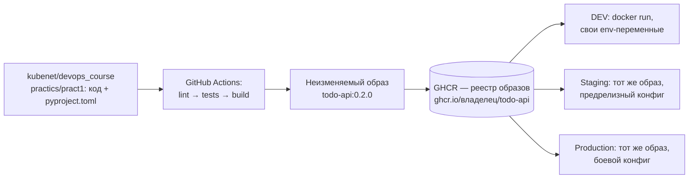
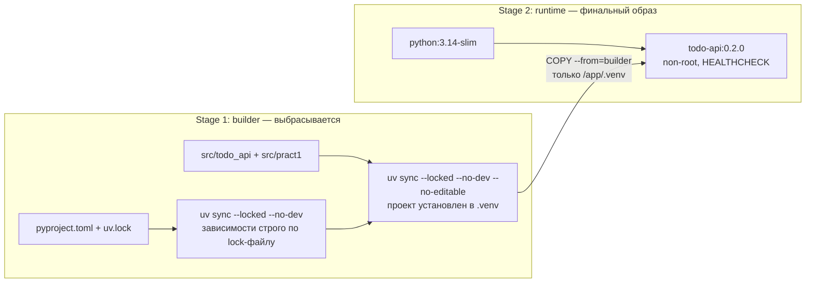
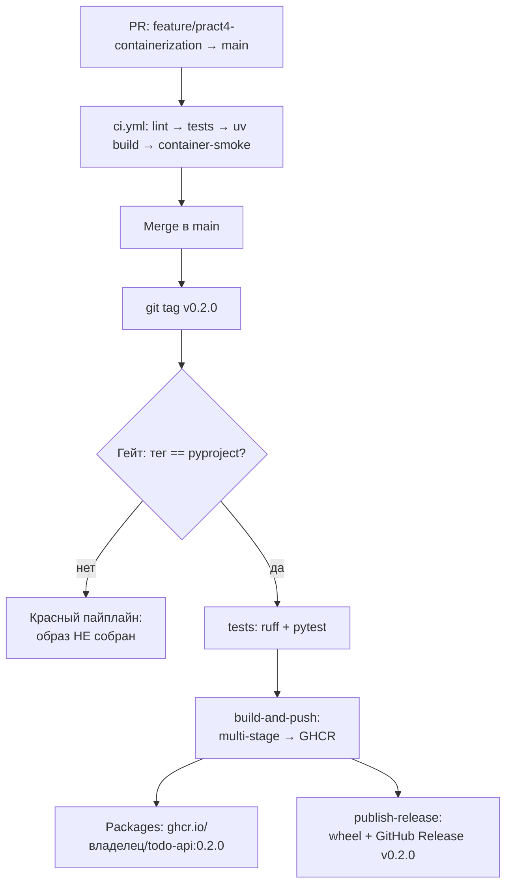

# Лекция 4. Непрерывная доставка (CD). Контейнеризация и управление артефактами

**Курс:** Управление изменениями и релизами программных систем
**Сквозной проект всех практик:** [`kubenet/devops_course`](https://github.com/kubenet/devops_course), рабочий каталог — `practics/pract1` (Todo API)
**Инструменты проекта:** Python 3.14, FastAPI, uv, pytest, ruff, GitHub Actions, GHCR
**Ветка практики:** `feature/pract4-containerization` → PR в `main` → тег `v0.2.0`

**Цель:** научиться упаковывать приложение так, чтобы оно работало одинаково в любой среде. После этой лекции фраза *«It works on my machine»* перестанет быть аргументом — «машину» мы поставим вместе с приложением.

**План (от общего к деталям):**
1. Проблема дрейфа окружений — и дрейф, который уже есть в нашем репозитории.
2. Место контейнеризации в CD. Артефакты.
3. Экосистема Docker: термины, аналогии, кейс Spotify.
4. Детали: слои, multi-stage, гигиена образа.
5. Версионирование: единый источник правды.
6. Практика на `devops_course`: аудит → патчи → Dockerfile → `build_and_push.py` → GitHub Actions → первый релиз в GHCR.
7. Практическое задание 4, критерии, контрольные вопросы, типовые ошибки.

---

## 1. Проблема: почему «у меня работает» — не аргумент

**Окружение (environment)** — всё, что нужно приложению кроме его кода: версия интерпретатора, библиотеки, системные пакеты, переменные окружения, пути. Три классических окружения: **DEV** (ноутбук разработчика), **Staging** (предрелизная копия прода), **Production** (боевая среда).

**Дрейф окружений (environment drift)** — постепенное расхождение конфигураций сред.

> **Кейс из практики.** Сервис на `psycopg2` (драйвер PostgreSQL) работал у разработчика, потому что у него случайно стояла системная библиотека `libpq`. На чистом сервере её не было — падение за 5 минут до релиза. Код версионировали в Git, а окружение — нет.

И тавкое бывает не только между машинами, но и **внутри одного репозитория**. В нашем `devops_course` прямо сейчас: `pyproject.toml` говорит `version = "0.1.0"`, а в `src/todo_api/app.py` зашито `FastAPI(..., version="0.2.0")`. Два «источника правды» уже разъехались — какой версии наш API? Никто не знает. Сегодня мы это починим системно.

**Вывод:** релиз — это не код. **Релиз = код + окружение + конфигурация**, и первые две составляющие обязаны путешествовать вместе. Это целое и называется артефактом.

---

## 2. Место контейнеризации в CD. Артефакты

Напомню определения прошлых лекций:
- **CI (Continuous Integration)** — частое слияние кода с автоматическим линтом/тестами. У нас это уже есть: ruff → pytest → uv build на каждый PR.
- **CD (Continuous Delivery, непрерывная доставка)** — после каждого успешного CI существует **готовый к выпуску артефакт**, а выпуск — рутинное безопасное действие. *Аналогия:* блюдо приготовлено и стоит на раздаче — осталось нажать «подать».

**Артефакт (artifact)** — неизменяемый версионированный результат сборки. В pract1 мы уже сделали первый артефакт — `todo-api-0.1.0.tar.gz` (скрипт `release.py` даже посчитал SHA-256 и записал `release_log.md`). Но tar.gz с исходниками **не фиксирует окружение**: какой Python поставит сервер, такие библиотеки и приедут. Сегодня мы соберем полноценный артефакт — **Docker-образ**, внутри которого зафиксировано всё.

**Неизменяемость (immutability):** образ `0.2.0` никогда не пересобирается «чуть иначе». Нашли баг — выпускаем `0.2.1`. *Аналогия:* запечатанная банка с номером партии; «немного подсолить» партию №100 нельзя — выпускаем №101.

Принцип, который реализуем: **«Build once, deploy many»** — один образ проходит DEV → Staging → Prod, меняется только конфигурация.



**Что на диаграмме:** жизненный путь артефакта нашего проекта. Из кода в `practics/pract1` конвейер собирает **один** образ, кладёт на «склад» GHCR, и один и тот же образ забирают все среды. Разница сред — только во внешних переменных окружения и томах. Если Staging ведёт себя иначе, чем Prod, — виновата конфигурация, и поиск проблемы сужается до одного списка переменных.

---

## 3. Экосистема Docker: термины и аналогии

**Docker** — платформа для разработки, доставки и запуска приложений в контейнерах.
*Аналогия:* **стандартизированный морской контейнер**: неважно, что внутри (машины, зерно, код) — краны и корабли (серверы и ОС) работают с ним одинаково.

**Container (контейнер)** — изолированный процесс со своей файловой системой, сетью и лимитами ресурсов. Не виртуальная машина: использует ядро хоста, стартует за миллисекунды.
*Пример:* запущенный Todo API на порту 8000. *Аналогия:* **испечённый по рецепту торт**.

**Image (образ)** — неизменяемый шаблон (слои ФС + метаданные: команда запуска, порты, пользователь), из которого создаются контейнеры.
*Пример:* `todo-api:0.2.0` — Python 3.14, наш пакет, зависимости из `uv.lock`. *Аналогия:* **рецепт торта** — по одному рецепту сто одинаковых тортов.

**Dockerfile** — файл-инструкция сборки образа; лежит в Git, поэтому **окружение теперь версионируется вместе с кодом**.

**Layer (слой)** — каждая инструкция Dockerfile создаёт слой; слои кэшируются. *Аналогия:* коржи торта — меняем верхний, нижние не перепекаем. *Следствие:* редко меняющееся (зависимости) — раньше в Dockerfile, часто меняющееся (код) — позже.

**Registry (реестр)** — сетевое хранилище образов с push/pull. **GHCR (GitHub Container Registry)** — реестр, встроенный в GitHub: `ghcr.io/владелец/todo-api:тег`. *Аналогия:* **склад партий**: фабрика (CI) производит, склад хранит, магазины (серверы) заказывают партию по номеру.

**Tag (тег)** — человекочитаемая метка (`0.2.0`, `latest`); это **указатель**, его можно перевесить. *Аналогия:* стикер на коробке.
**Digest (дайджест)** — хеш содержимого `sha256:…`, **неизменяемая** ссылка на байт-в-байт тот же образ. *Аналогия:* отпечаток пальца коробки. В прод — по SemVer-тегу, а лучше по digest.

**Docker daemon** — фоновый сервис, который собирает и запускает; **Docker CLI** — командная строка. *Аналогия:* CLI — официант, daemon — кухня; не запущен Docker Desktop — «официант кричит на пустую кухню».

**OCI (Open Container Initiative)** — открытый стандарт образов: наш образ поймут Podman, containerd, Kubernetes. «Морской контейнер» стандартизирован — его берёт любой порт.

> ### Реальный кейс: Spotify
> Spotify контейнеризировал сервисы, чтобы стандартизировать среду для сотен команд. Раньше новый микросервис = ручная настройка ОС на серверах, недели согласований. После — окружение описано в Dockerfile, платформа принимает любой контейнер: развёртывание сократилось **с недель до минут**. Spotify даже открыл свой оркестратор Helios, позже мигрировал на Kubernetes, но единицей доставки навсегда стал **образ**, а не «инструкция сисадмину». Ответственность за окружение переехала в репозиторий команды — ровно то, что мы делаем с `practics/pract1`.

---

## 4. Детали: multi-stage, размер, гигиена образа

### 4.1. Multi-stage build

Наивный образ тащит в прод компиляторы, кэши, исходники, тесты → гигабайты, медленный pull, медленный откат, широкая **поверхность атаки** (набор инструментов, доступных злоумышленнику при взломе приложения).

**Multi-stage build (многоэтапная сборка)** — несколько блоков `FROM`: «builder» собирает всё с инструментами, «runtime» забирает через `COPY --from=builder` **только готовый результат**. *Аналогия:* стройка и дом: леса и бетономешалки нужны при стройке, но жильцы въезжают без них.



**Что на диаграмме:** слева — «стройплощадка» с uv, исходниками и кэшами; справа — финальный образ: чистая база плюс готовое виртуальное окружение. Единственный мост — `COPY --from`. Точные размеры вы измерите сами в эксперименте.

Новые термины проекта:
- **uv** — быстрый менеджер пакетов и проектов Python (замена pip+venv+pip-tools), уже используется в нашем CI. **`uv.lock`** — lock-файл: точные версии **всех** зависимостей до хеша. *Аналогия:* рецепт с точностью до грамма — «fastapi>=0.162» это «примерно стакан муки», а lock — «125 г муки марки X». Именно lock делает образ воспроизводимым.
- **venv** — изолированная папка с интерпретатором и пакетами (uv создаёт `.venv`). Переносится целиком — этим и пользуется multi-stage.
- **Wheel (.whl)** — стандартный установочный архив Python-пакета; наш CI уже собирает его (`uv build`). Сегодня из одного кода выйдет **два артефакта**: wheel (в GitHub Release) и образ (в GHCR).

### 4.2. Базовый образ: slim vs alpine

**Base image** — образ в `FROM`. `python:3.14` — полный Debian ~1 ГБ; **`python:3.14-slim`** — урезанный, ~150 МБ, наш выбор (совпадает с `.python-version` проекта).

> **Кейс-ловушка Alpine.** Команда взяла alpine ради «минус 50 МБ», но там musl вместо glibc: готовые manylinux-wheel'ы не подходят, pip начал компилировать C-зависимости — сборка выросла с 2 до 20 минут. Правило: **slim по умолчанию, alpine — только после измерений.**

### 4.3. Гигиена продакшен-образа (применим ниже)

1. **Non-root**: создаём `appuser`, `USER appuser`. Root внутри взломанного контейнера — лишний подарок атакующему. *Аналогия:* курьеру — пропуск в зону погрузки, не мастер-ключ.
2. **HEALTHCHECK** — команда самопроверки; у нас есть готовый `/health` — идеально.
3. **Volume (том)** — каталог вне контейнера, переживает `docker rm`. ФС контейнера эфемерна. *Аналогия:* камера хранения: чемодан меняем, ячейка остаётся. У Todo API данные **в оперативной памяти** — сегодня увидим, что это значит, и добавим снапшот в том.
4. **Конфигурация снаружи образа** — env-переменные (`TODO_DATA_PATH` и т.п.).
5. **Build context** — папка, отправляемая демону при сборке; **`.dockerignore`** исключает мусор и секреты. *Кейс:* у команды в контекст улетел `.env` с токеном — токен извлекли из слоя через `docker history`. Слои помнят всё.

---

## 5. Версионирование: единый источник правды

**SemVer** — `MAJOR.MINOR.PATCH`: несовместимые изменения / новая функциональность / багфикс. Наш план: pract1 жил на `0.1.0`; контейнерная упаковка + снапшот задач — новая функциональность → **`0.2.0`** (MINOR). Забавно, что `app.py` уже называл себя «0.2.0» — приведём `pyproject.toml` к реальности и устраним дрейф.

**Единый источник правды (single source of truth)** — поле `version` в `pyproject.toml`. Всё остальное — производные: приложение читает версию из метаданных установленного пакета (`importlib.metadata`), `build_and_push.py` — через `tomllib`, пайплайн сверяет git-тег с `pyproject.toml` и **запрещает релиз при расхождении**. Заметьте: `release.py` из pract1 парсил версию построчно «на глазок» — сегодня заменим на честный `tomllib`.

**Антипаттерн `latest`.**
> **Кейс:** деплой по `app:latest`; в пятницу в прод уехал баг, «откат на latest» невозможен — latest уже указывает на сломанный образ, старых тегов нет. Три часа простоя. Правило: **прод — только SemVer-тег или digest; latest — удобство для локалки.**

---

## 6. Практика: всё в `kubenet/devops_course`

### 6.0. Подготовка и аудит (как перед любым изменением)

Работаем в **своём форке** сквозного репозитория (кнопка **Fork** на GitHub), чтобы пушить ветки, теги и пакеты:

```bash
git clone https://github.com/<ВАШ_ЛОГИН>/devops_course.git
cd devops_course
git checkout -b feature/pract4-containerization   # ci.yml уже слушает feature/**
cd practics/pract1
uv sync                        # репетиция: проект должен ставиться локально
uv run pytest -q
```

**Аудит текущего состояния** (фиксируем в описании PR — это наш «change request»):

| № | Находка в репозитории | Почему это проблема | Решение в этой практике |
|---|---|---|---|
| 1 | `ci.yml` лежит **в корне** репозитория | GitHub исполняет workflow **только** из `.github/workflows/` — корневой файл мёртв | `git mv ci.yml .github/workflows/ci.yml` |
| 2 | `.github/workflows/python-app.yml` дублирует тот же CI (создан из шаблона) | Два одинаковых конвейера = двойные прогоны и путаница | `git rm .github/workflows/python-app.yml` |
| 3 | Версия: `pyproject.toml` = 0.1.0, `app.py` = "0.2.0" | Дрейф источников правды | Приложение читает метаданные пакета; bump до 0.2.0 при релизе |
| 4 | В зависимостях нет `ruff` и `pytest-cov`, а CI их вызывает; `httpx2` похож на опечатку (`TestClient` требует `httpx`) | CI не сможет пройти lint/coverage | DEV-группа зависимостей в `pyproject.toml` |
| 5 | Тест `test_create_empty_title_returns_422` ожидает валидацию, которой в `TodoCreate` нет | Тест описывает требование, код его не выполняет | Валидация `title` (strip + min_length) |
| 6 | `uv_build` по умолчанию пакует только модуль `pract1`; `todo_api` в wheel не попадёт | Установленный пакет не сможет обслужить API | `module-name = ["pract1", "todo_api"]` |

*Педагогический смысл:* управление изменениями начинается не с кода, а с **диагностики и явно зафиксированного плана изменения** — как врач перед операцией.

### 6.1. Патчи существующего проекта

**`practics/pract1/pyproject.toml`** (правки помечены комментариями):

```toml
[project]
name = "pract1"
version = "0.1.0"                  # на шаге релиза поднимем до 0.2.0 (MINOR)
description = "Сквозной проект курса: Todo API"
readme = "README.md"
requires-python = ">=3.14"
dependencies = [
    "fastapi>=0.162.2",
    "uvicorn>=0.54.0",
]                                  # ПРАВКА: только runtime-зависимости

# ПРАВКА: DEV-группа — ставится uv sync по умолчанию, НЕ ставится в образ (--no-dev)
[dependency-groups]
dev = [
    "pytest>=9.2.0",
    "httpx>=0.28",                 # ПРАВКА: TestClient требует httpx (не httpx2)
    "pytest-cov>=6",               # ПРАВКА: нужен CI-шагу --cov
    "ruff>=0.8",                   # ПРАВКА: нужен CI-шагу ruff
]

[project.scripts]
pract1 = "pract1:main"

[build-system]
requires = ["uv_build>=0.13.7,<0.14.0"]
build-backend = "uv_build"

# ПРАВКА:.packaging оба модуля, иначе todo_api не попадёт в wheel/.venv
[tool.uv.build-backend]
module-name = ["pract1", "todo_api"]

[tool.pytest.ini_options]
testpaths = ["test"]
addopts = "-ra --strict-markers"
```

После правки: `uv lock && uv sync` (lock обязан перегенерироваться и попасть в коммит), затем проверка упаковки: `uv build` и посмотрите содержимое wheel — внутри должен быть `todo_api/` (`python -m zipfile -l dist/*.whl`).

**`src/todo_api/app.py`** — три точечных патча.

*Патч 1 — версия из метаданных (конец дрейфа):*

```python
# вместо app = FastAPI(title="Todo API", version="0.2.0")
from importlib import metadata

def get_version() -> str:
    """Версия установленного дистрибутива pract1 (т.е. из pyproject.toml).
    Если пакет не установлен (запуск из исходников) — явная dev-заглушка."""
    try:
        return metadata.version("pract1")
    except metadata.PackageNotFoundError:
        return "0.0.0.dev0"
```

*Патч 2 — валидация заголовка (тест уже требовал её):*

```python
from typing import Annotated
from pydantic import BaseModel, StringConstraints

# Обрезаем пробелы и запрещаем пустую строку -> "   " даст 422, как ждёт тест
Title = Annotated[str, StringConstraints(strip_whitespace=True, min_length=1)]

class TodoCreate(BaseModel):
    title: Title
    completed: bool = False

class TodoUpdate(BaseModel):
    title: Title
    completed: bool
```

*Патч 3 — снапшот состояния (новая MINOR-фича ради томов).* Сейчас `todos` живёт в RAM и умирает с процессом. Добавим явное сохранение/загрузку JSON-снапшота; путь — из переменной окружения (конфигурация снаружи!):

```python
import json, os
from contextlib import asynccontextmanager
from pathlib import Path

def _data_file() -> Path | None:
    """Путь снапшота из env. Не задан — работаем чисто в памяти (как раньше)."""
    p = os.getenv("TODO_DATA_PATH")
    return Path(p) if p else None

def save_snapshot() -> Path:
    target = _data_file()
    if target is None:
        # 409 Conflict: конфликт с текущей конфигурацией сервиса
        raise HTTPException(status_code=409, detail="TODO_DATA_PATH не задан")
    target.parent.mkdir(parents=True, exist_ok=True)
    target.write_text(json.dumps({"todos": todos, "next_id": _next_id}, ensure_ascii=False))
    return target

def load_snapshot() -> None:
    global _next_id
    target = _data_file()
    if target and target.exists():
        data = json.loads(target.read_text())
        todos[:] = data["todos"]
        _next_id = data["next_id"]

@asynccontextmanager
async def lifespan(app: FastAPI):
    """Lifespan: код до yield — при старте, после — при остановке."""
    load_snapshot()
    yield

app = FastAPI(title="Todo API", version=get_version(), lifespan=lifespan)

@app.post("/backup", status_code=201)
def backup():
    """Явное сохранение снапшота задач (в контейнере — в том /data)."""
    path = save_snapshot()
    return {"saved": str(path), "count": len(todos)}
```

**Новые модульные тесты** (каждая проверка — отдельный тест, изолированный файл снапшота на каждый тест — рабочая «БД» не затрагивается):

```python
# test/test_version.py — гейт целостности версии на уровне приложения
from importlib import metadata
from fastapi.testclient import TestClient
from todo_api.app import app

def test_health_version_equals_package_metadata():
    with TestClient(app) as client:
        assert client.get("/health").json()["version"] == metadata.version("pract1")
```

```python
# test/test_persistence.py — снапшот: изоляция через tmp_path + monkeypatch
import json
import pytest
from fastapi.testclient import TestClient
import todo_api.app as m

@pytest.fixture(autouse=True)
def clean_state(monkeypatch, tmp_path):
    """Своя тестовая 'БД' на каждый тест; рабочая не трогается никогда."""
    monkeypatch.setenv("TODO_DATA_PATH", str(tmp_path / "todo_tests.json"))
    m.todos.clear()
    yield
    m.todos.clear()

def test_backup_writes_snapshot():
    with TestClient(m.app) as client:
        client.post("/todos", json={"title": "Изучить Docker"})
        r = client.post("/backup")
        assert r.status_code == 201
        data = json.loads((m._data_file()).read_text())
        assert data["todos"][0]["title"] == "Изучить Docker"

def test_load_snapshot_restores_state():
    with TestClient(m.app) as client:
        client.post("/todos", json={"title": "Переживу рестарт"})
        client.post("/backup")
        m.todos.clear()                      # имитация «нового процесса»
        m.load_snapshot()
        assert client.get("/todos").json()[0]["title"] == "Переживу рестарт"

def test_backup_without_path_returns_409(monkeypatch):
    monkeypatch.delenv("TODO_DATA_PATH")
    with TestClient(m.app) as client:
        assert client.post("/backup").status_code == 409
```

Прогон: `uv run pytest -q` — все тесты, включая ранее падавший 422, зелёные. Коммиты дробные: `fix(ci): ...`, `fix(api): валидация title`, `feat(api): снапшот задач`, `test: ...`.

### 6.2. `Dockerfile` (multi-stage, uv) и `.dockerignore`

Кладём в `practics/pract1/`:

```dockerfile
# syntax=docker/dockerfile:1
# ========== Stage 1: BUILDER — «стройплощадка» ==========
FROM python:3.14-slim AS builder

# uv берём из официального образа, версию фиксируем (парность с uv_build<0.14)
COPY --from=ghcr.io/astral-sh/uv:0.13 /uv /uvx /bin/

ENV UV_COMPILE_BYTECODE=1 \
    UV_LINK_MODE=copy \
    UV_PYTHON_DOWNLOADS=0
# UV_COMPILE_BYTECODE: прекомпиляция .pyc при сборке (быстрее старт)
# UV_LINK_MODE=copy: копирование вместо hardlink между слоями
# UV_PYTHON_DOWNLOADS=0: используем Python базового образа, не качаем свой

WORKDIR /app
# Слой 1: зависимости. Меняется редко -> кэш работает.
# README.md обязателен: pyproject ссылается на readme, uv_build его читает!
COPY pyproject.toml uv.lock README.md ./
RUN uv sync --locked --no-dev --no-install-project

# Слой 2: код проекта. Меняется часто -> пересобирается только этот слой.
COPY src ./src
# --no-editable КРИТИЧНО: ставим пакет «по-настоящему» в .venv,
# иначе .venv будет ссылаться на /app/src, которого в runtime не будет.
RUN uv sync --locked --no-dev --no-editable

# ========== Stage 2: RUNTIME — «дом без лесов» ==========
FROM python:3.14-slim AS runtime

ENV PATH="/app/.venv/bin:$PATH" \
    PYTHONUNBUFFERED=1 \
    PYTHONDONTWRITEBYTECODE=1 \
    TODO_DATA_PATH=/data/todos.json

RUN useradd --create-home --uid 10001 appuser \
 && mkdir -p /data && chown -R appuser:appuser /data

# Единственный мост из builder: готовое окружение, и больше ничего
COPY --from=builder /app/.venv /app/.venv

WORKDIR /app
USER appuser
EXPOSE 8000

HEALTHCHECK --interval=30s --timeout=3s --start-period=5s --retries=3 \
  CMD python -c "import urllib.request as u; u.urlopen('http://127.0.0.1:8000/health', timeout=2)" || exit 1

CMD ["uvicorn", "todo_api.app:app", "--host", "0.0.0.0", "--port", "8000"]
```

```text
# practics/pract1/.dockerignore
.venv
dist
test
scripts
local_registry
release_log.md
__pycache__/
*.pyc
.pytest_cache
.ruff_cache
junit.xml
coverage.xml
*.tar
*.tar.gz
```

Для эксперимента — наивный антипример `Dockerfile.single`:

```dockerfile
# АНТИПРИМЕР: полный базовый образ, всё внутри, root, кэши pip
FROM python:3.14
WORKDIR /app
COPY . .
RUN pip install .
EXPOSE 8000
CMD ["uvicorn", "todo_api.app:app", "--host", "0.0.0.0", "--port", "8000"]
```

### 6.3. Локальная сборка и три эксперимента

Все команды — из `practics/pract1` (репетиция того, что потом сделает Actions):

```bash
# Сборка
docker build -t todo-api:0.2.0 -t todo-api:latest .

# Запуск: порт + ТОМ для снапшотов
docker run -d --name todo -p 8000:8000 -v todo-data:/data todo-api:0.2.0

# Проверка
curl http://localhost:8000/health     # {"status":"ok","version":"0.2.0"} <- из pyproject!
docker inspect --format "{{.State.Health.Status}}" todo   # через ~30с: healthy
```

**Эксперимент 1 — «состояние в RAM умирает».**
```bash
curl -X POST http://localhost:8000/todos -H "Content-Type: application/json" -d '{"title":"Задача без бэкапа"}'
docker rm -f todo
docker run -d --name todo -p 8000:8000 -v todo-data:/data todo-api:0.2.0
curl http://localhost:8000/todos      # [] — задача исчезла: том ни при чём, данные были в памяти
```

**Эксперимент 2 — «явный снапшот + том переживают контейнер».**
```bash
curl -X POST http://localhost:8000/todos -H "Content-Type: application/json" -d '{"title":"Переживу релиз"}'
curl -X POST http://localhost:8000/backup     # {"saved":"/data/todos.json","count":1}
docker rm -f todo
docker run -d --name todo -p 8000:8000 -v todo-data:/data todo-api:0.2.0
curl http://localhost:8000/todos      # задача на месте: lifespan загрузил снапшот из тома
```
*Интерпретация:* контейнер — «торт», его съели и испекли новый из того же «рецепта»; «ячейка камеры хранения» (том) сохранила состояние. Это фундамент разговора о stateless-сервисах и БД на следующих лекциях.

**Эксперимент 3 — цена «строительных лесов».**
```bash
docker build -f Dockerfile.single -t todo-api:single .
docker images "todo-api*"        # сравните SIZE: ~1 ГБ vs ~200 МБ
docker history todo-api:0.2.0    # какие слои сколько весят
```

### 6.4. `scripts/build_and_push.py` — эволюция `release.py` из pract1

Скрипт pract1 умел tar.gz + SHA-256 + `release_log.md`. Наш наследник делает то же для **образа**: версия — честно через `tomllib` (никакого построчного парсинга), имя образа `todo-api` — как `PROJECT_NAME` в pract1 (имя дистрибутива `pract1` и имя образа — разные сущности, версия у них одна). По умолчанию — **имитация push** (склад = `local_registry/`), с `--push` — реальный GHCR. Только stdlib.

**`subprocess`** — модуль запуска внешних программ; команды передаём списком (без `shell=True`), токен — через stdin (`--password-stdin`), чтобы не светился в истории и списке процессов.

```python
#!/usr/bin/env python3
"""
build_and_push.py — pract4: сборка образа todo-api, тег из pyproject.toml,
имитация push (по умолчанию) или реальный push в GHCR (--push).

  uv run python scripts/build_and_push.py                      # имитация
  uv run python scripts/build_and_push.py --owner <логин> --push
Перед --push: экспортируйте GHCR_TOKEN (PAT c write:packages).
"""
from __future__ import annotations

import argparse, hashlib, json, logging, os, re, subprocess, sys, tomllib
from datetime import datetime, timezone
from pathlib import Path

ROOT = Path(__file__).resolve().parents[1]        # practics/pract1
IMAGE_DEFAULT = "todo-api"                        # преемственность с release.py pract1
SEMVER = re.compile(r"^\d+\.\d+\.\d+$")
log = logging.getLogger("build_and_push")


def run(cmd: list[str], *, input_text: str | None = None) -> None:
    """check=True: ненулевой код = остановка. Токен идёт в stdin, не в argv."""
    log.info("$ %s", " ".join(cmd))
    try:
        subprocess.run(cmd, check=True, input=input_text, text=True)
    except FileNotFoundError:
        log.error("Docker CLI не найден: установлен ли Docker, запущен ли демон?")
        sys.exit(2)
    except subprocess.CalledProcessError as e:
        log.error("Команда упала с кодом %s — релиз остановлен.", e.returncode)
        sys.exit(e.returncode or 1)


def read_version() -> str:
    """Единый источник правды — pyproject.toml (tomllib, а не парсинг строк)."""
    with (ROOT / "pyproject.toml").open("rb") as f:
        version = tomllib.load(f)["project"]["version"]
    if not SEMVER.match(version):
        log.warning("Версия %r не похожа на SemVer — проверьте!", version)
    return version


def sha256_of(path: Path) -> str:
    """Потоковый SHA-256 — как в release.py pract1 (не грузим файл целиком)."""
    h = hashlib.sha256()
    with path.open("rb") as f:
        for chunk in iter(lambda: f.read(8192), b""):
            h.update(chunk)
    return h.hexdigest()


def build(refs: list[str]) -> None:
    cmd = ["docker", "build"]
    for ref in refs:
        cmd += ["-t", ref]
    cmd += [str(ROOT)]
    run(cmd)


def append_release_log(mode: str, version: str, entries: list[dict]) -> None:
    """Дописываем контейнерный релиз в release_log.md — журнал pract1 продолжается."""
    lines = [f"\n## todo-api v{version} — контейнерный релиз ({mode})\n",
             f"- **Дата:** {datetime.now(timezone.utc):%Y-%m-%d %H:%M:%S UTC}\n"]
    for e in entries:
        lines.append(f"- **Образ:** `{e['ref']}`\n")
        if "sha256_of_tar" in e:
            lines.append(f"- **SHA-256 (tar):** `{e['sha256_of_tar']}`\n")
            lines.append(f"- **Размер:** {e['size_bytes']} байт\n")
    with (ROOT / "release_log.md").open("a", encoding="utf-8") as f:
        f.writelines(lines)


def simulate_push(refs: list[str], version: str) -> None:
    """Имитация реестра: 'склад' — local_registry/todo-api/.
    docker save = образ со всеми слоями в tar; реестр хранит то же самое."""
    warehouse = ROOT / "local_registry" / IMAGE_DEFAULT
    warehouse.mkdir(parents=True, exist_ok=True)
    index_file = warehouse / "index.json"
    index = json.loads(index_file.read_text()) if index_file.exists() else {}
    entries = []
    for ref in refs:
        tag = ref.rsplit(":", 1)[1]
        tar = warehouse / f"{tag}.tar"
        run(["docker", "save", "-o", str(tar), ref])
        entry = {"ref": ref, "file": tar.name, "size_bytes": tar.stat().st_size,
                 "sha256_of_tar": sha256_of(tar),   # NB: настоящий digest считают от
                 "saved_at": datetime.now(timezone.utc).isoformat()}  # manifest; тут упрощение
        index[tag] = entry
        entries.append(entry)
        log.info("Партия '%s' на складе: %s (%.1f МБ)", tag, tar.name, entry["size_bytes"]/1e6)
    index_file.write_text(json.dumps(index, indent=2, ensure_ascii=False))
    append_release_log("имитация", version, entries)
    log.info("Откат со склада возможен: docker load -i %s/0.2.0.tar", warehouse)


def real_push(refs: list[str], args: argparse.Namespace, version: str) -> None:
    token = os.getenv("GHCR_TOKEN")
    if not token:
        log.error("Нет GHCR_TOKEN: создайте PAT (classic) c write:packages/read:packages. "
                  "Токен в коде и git хранить НЕЛЬЗЯ.")
        sys.exit(2)
    run(["docker", "login", args.registry, "-u", args.owner, "--password-stdin"],
        input_text=token + "\n")
    for ref in refs:
        run(["docker", "push", ref])
    append_release_log("GHCR", version, [{"ref": r} for r in refs])
    log.info("Готово: %s", ", ".join(refs))


def main() -> None:
    logging.basicConfig(level=logging.INFO, format="%(levelname)s | %(message)s")
    p = argparse.ArgumentParser(description="Build & push todo-api (SemVer из pyproject)")
    p.add_argument("--registry", default="ghcr.io")
    p.add_argument("--owner", default="kubenet", help="логин GitHub (в форке — свой)")
    p.add_argument("--name", default=IMAGE_DEFAULT)
    p.add_argument("--push", action="store_true", help="реальный push (иначе имитация)")
    args = p.parse_args()

    version = read_version()
    image = f"{args.registry}/{args.owner.lower()}/{args.name}".lower()  # GHCR: только lowercase
    refs = [f"{image}:{version}", f"{image}:latest"]
    log.info("todo-api, версия из pyproject.toml: %s", version)
    build(refs)
    real_push(refs, args, version) if args.push else simulate_push(refs, version)


if __name__ == "__main__":
    main()
```

Запуск и проверка «отката со склада»:

```bash
uv run python scripts/build_and_push.py
docker load -i local_registry/todo-api/0.1.0.tar   # артефакт самодостаточен
```

Реальный push вручную требует **PAT (Personal Access Token)** — персональный токен GitHub для CLI/API: Settings → Developer settings → Personal access tokens → **Tokens (classic)** → scopes `write:packages`, `read:packages`:

```bash
export GHCR_TOKEN=ghp_XXXX       # PowerShell: $env:GHCR_TOKEN="ghp_..."
uv run python scripts/build_and_push.py --owner <ВАШ_ЛОГИН> --push
```

### 6.5. GitHub Actions: чиним CI и добавляем CD

Термины: **GitHub Actions** — автоматизация внутри GitHub; **Workflow** — YAML в `.github/workflows/`; **Job** — блок на своей машине, **Step** — шаг (команда или **action** — переиспользуемый «кубик», например `actions/checkout`); **Runner** — машина-исполнитель (`ubuntu-latest` — арендуемая у GitHub); **`GITHUB_TOKEN`** — служебный токен каждого запуска («пропуск робота-сборщика»), права задаются в `permissions` — личные PAT в workflow не нужны.

**Шаг 1 — переносим и чиним CI:**

```bash
git mv ci.yml .github/workflows/ci.yml
git rm .github/workflows/python-app.yml     # дубликат шаблона — убираем
```

В перенесённом `ci.yml` — две правки: триггер теперь ловит и `main`, и добавлен smoke-тест контейнера (остальное — как было, включая `working-directory: practics/pract1` и uv):

```yaml
on:
  push:
    branches: ["feature/**", "main"]      # ПРАВКА: main тоже проверяем
    paths:
      - "practics/pract1/**"
      - ".github/workflows/ci.yml"
  pull_request:
    branches: [main]
```

```yaml
  # НОВЫЙ job в конце ci.yml: каждый PR проверяет, что образ вообще жив
  container-smoke:
    name: Container smoke test
    needs: test
    runs-on: ubuntu-latest
    steps:
      - uses: actions/checkout@v5
      - name: Build image (без push!)
        run: docker build -t todo-api:smoke practics/pract1
      - name: Run & probe
        run: |
          docker run -d --name smoke -p 8000:8000 todo-api:smoke
          for i in $(seq 1 15); do
            sleep 2
            curl -fsS http://localhost:8000/health && exit 0
          done
          docker logs smoke; exit 1
```

**Шаг 2 — новый `.github/workflows/release.yml` (CD):**

```yaml
name: Release
on:
  push:
    tags: ["v*.*.*"]         # git tag v0.2.0 && git push origin v0.2.0
  workflow_dispatch:

permissions:
  contents: write            # GitHub Release + wheel
  packages: write            # push в GHCR через GITHUB_TOKEN

defaults:
  run:
    working-directory: practics/pract1

jobs:
  gate:
    name: Гейт — тег == pyproject.toml
    runs-on: ubuntu-latest
    steps:
      - uses: actions/checkout@v5
      - name: Compare tag with pyproject
        run: |
          VERSION=$(python3 -c "import tomllib;print(tomllib.load(open('pyproject.toml','rb'))['project']['version'])")
          echo "pyproject: $VERSION"
          if [ "$GITHUB_REF_TYPE" = "tag" ]; then
            TAG="${GITHUB_REF_NAME#v}"
            if [ "$TAG" != "$VERSION" ]; then
              echo "::error::Тег $TAG != pyproject $VERSION — релиз ЗАПРЕЩЁН"; exit 1
            fi
          fi

  tests:
    needs: gate              # тег мог указывать на непроверенный коммит — проверяем снова
    runs-on: ubuntu-latest
    steps:
      - uses: actions/checkout@v5
      - uses: astral-sh/setup-uv@v7
        with:
          enable-cache: true
          cache-dependency-glob: "practics/pract1/uv.lock"
      - run: uv sync --locked
      - run: uv run ruff check .
      - run: uv run pytest -q

  build-and-push:
    needs: tests
    runs-on: ubuntu-latest
    steps:
      - uses: actions/checkout@v5
      - uses: docker/setup-buildx-action@v3
      - uses: docker/login-action@v3
        with:
          registry: ghcr.io
          username: ${{ github.actor }}
          password: ${{ secrets.GITHUB_TOKEN }}
      - id: meta
        uses: docker/metadata-action@v5
        with:
          images: ghcr.io/${{ github.repository_owner }}/todo-api
          tags: |
            type=semver,pattern={{version}}
            type=raw,value=latest
      - uses: docker/build-push-action@v6
        with:
          context: practics/pract1          # NB: context — от КОРНЯ репо,
          file: practics/pract1/Dockerfile  # working-directory на actions не влияет
          push: true
          tags: ${{ steps.meta.outputs.tags }}
          labels: ${{ steps.meta.outputs.labels }}
          cache-from: type=gha
          cache-to: type=gha,mode=max

  publish-release:
    needs: build-and-push
    if: startsWith(github.ref, 'refs/tags/v')
    runs-on: ubuntu-latest
    steps:
      - uses: actions/checkout@v5
      - uses: astral-sh/setup-uv@v7
      - name: Build wheel (артефакт №1, как в pract1)
        run: uv build
      - name: GitHub Release + wheel
        env:
          GH_TOKEN: ${{ secrets.GITHUB_TOKEN }}
        run: gh release create "$GITHUB_REF_NAME" dist/* --generate-notes --title "todo-api $GITHUB_REF_NAME"
```



**Что на диаграмме:** полный путь изменения в нашем репозитории — от PR (ворота качества CI, теперь и smoke-тест образа) через merge к релизному тегу. Ромб — «таможня»: расхождение тега и `pyproject.toml` останавливает конвейер **до сборки**. Дальше два артефакта из одного источника правды: образ на складе GHCR и wheel в GitHub Release — прямое развитие того, что pract1 делал вручную.

### 6.6. Первый релиз проекта: v0.2.0

1. Запушьте ветку, откройте **PR в main** с описанием аудита и изменений → дождитесь зелёного CI (lint/test/build/smoke) → merge. Это наш процесс управления изменениями в миниатюре.
2. Bump версии: в `pyproject.toml` → `version = "0.2.0"`, `uv lock`, коммит через короткий PR, merge.
3. Релиз: `git checkout main && git pull && git tag v0.2.0 && git push origin v0.2.0` → вкладка **Actions** → workflow **Release**.
4. **Packages** на главной репозитория → `todo-api` → Package settings → **Change visibility → Public** (для учебной проверки pull).
5. Проверка «с чужого сервера»:

```bash
docker rmi todo-api:0.2.0 todo-api:latest 2>/dev/null
docker pull ghcr.io/<ВАШ_ЛОГИН>/todo-api:0.2.0
docker run -d --name from-ghcr -p 8001:8000 -v ghcr-data:/data ghcr.io/<ВАШ_ЛОГИН>/todo-api:0.2.0
curl http://localhost:8001/health    # {"status":"ok","version":"0.2.0"} — та самая партия
```

6. **Эксперимент с гейтом (обязателен):** не меняя `pyproject.toml`, запушьте тег `v0.2.1` → workflow обязан упасть на `gate`. Удалите тег (`git tag -d v0.2.1 && git push origin :refs/tags/v0.2.1`), поднимите версию до `0.2.1` (PATCH — например, верните два закомментированных теста `/stats` в `test_app.py` и убедитесь, что они зелёные), через PR → merge → тег → зелёный релиз. Вы прочувствовали, зачем релиз-инженеру таможня.
7. Допишите `release_log.md` (скрипт уже добавил секцию) — журнал релизов проекта непрерывен с pract1.

### 6.7. На вырост
- **SBOM (Software Bill of Materials)** — машиночитаемая «ведомость ингредиентов» образа: при новости об уязвимости библиотеки за минуты отвечаете, какие версии `todo-api` затронуты.
- **Подпись образов (cosign/sigstore)** — сервер перед запуском проверяет, что образ собран вашим конвейером, а не подменён на складе.
- **Retention policy** — политика хранения в реестре: все SemVer-теги храним, промежуточные чистим.
- **Пиннинг по digest** — `image: …@sha256:…` — высшая гарантия неизменяемости при деплое.

---

## 7. Практическое задание 4 (всё — в вашем форке `devops_course`)

**Часть A. Аудит и патчи.** Ветка `feature/pract4-containerization`: перенос `ci.yml`, удаление дубля, DEV-группа зависимостей, `module-name`, динамическая версия, валидация `title`, снапшот + новые тесты. Все тесты зелёные локально и в PR. В описании PR — таблица аудита «находка → решение».

**Часть B. Multi-stage Dockerfile.** Соберите образ, запустите с томом, покажите `/health` с версией из `pyproject.toml`. Проведите эксперименты 1 и 2 (RAM-состояние vs снапшот в томе) — скриншоты обоих.

**Часть C. Измерение и интерпретация.** Наивный `Dockerfile.single` vs multi-stage: `docker images`, `docker history`. В отчёте своими словами: какие слои дали разницу и почему это ускоряет откат.

**Часть D. `build_and_push.py`.** Оба режима: имитация (tar + `index.json` + запись в `release_log.md`, восстановление через `docker load`) и реальный push в GHCR (скриптом с PAT **или** через Actions — минимум один реальный push обязателен).

**Часть E. Релизный конвейер.** Зелёный Release `v0.2.0`: образ в Packages, wheel в Releases. Красный прогон гейта на рассогласованном теге + корректный `v0.2.1`. Pull образа «с чистого листа» и скриншот `/health`.

**Сдать:** ссылки на PR, зелёный и красный run, пакет в GHCR, GitHub Release; скриншоты экспериментов; обновлённый `release_log.md` в репозитории.

**Критерии:** версия только в `pyproject.toml`; в runtime нет исходников/тестов/uv; контейнер non-root; секреты не в git и не в слоях; `uv.lock` закоммичен и соответствует `pyproject.toml`; гейт реально останавливает релиз.

**Контрольные вопросы:**
1. Образ vs контейнер — и что это даёт при откате?
2. Почему `latest` опасен и чем digest надёжнее тега?
3. Что переносит `COPY --from=builder` и зачем `--no-editable`?
4. Зачем `uv.lock`, если есть `pyproject.toml`? («примерно стакан» vs «125 г»)
5. Почему корневой `ci.yml` никогда не запускался?
6. Почему данные в RAM исчезли, а снапшот в томе — нет?
7. `GITHUB_TOKEN` vs PAT: где какой использовали и почему?
8. Зачем гейт «тег == pyproject», если тесты и так зелёные?

**Типовые ошибки и лечение:**
- `Cannot connect to the Docker daemon` → не запущен Docker Desktop.
- `uv sync` / `uv build`: «readme file missing» → в builder не скопирован `README.md`.
- `ModuleNotFoundError: todo_api` в контейнере → забыт `module-name = ["pract1", "todo_api"]` или `--no-editable`.
- `ruff: command not found` в CI → не добавлена DEV-группа / не перегенерирован `uv.lock`.
- `denied` при push/pull GHCR → PAT без `write:packages`, чужой owner, приватный пакет, заглавные буквы в имени.
- `port is already allocated` → `-p 8001:8000`.
- Тег есть, Release не стартовал → тег не запушен (`git push origin v0.2.0`).
- Docker-сборка в Actions «не видит» Dockerfile → `context`/`file` указываются от корня репо, а не от `working-directory`.

---

